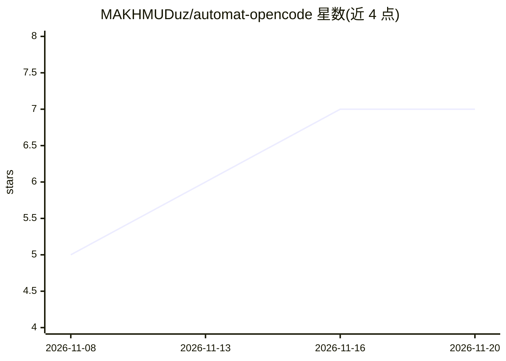

# MAKHMUDuz/automat-opencode

⭐ 7 · TypeScript · MIT · 推送 2026-11-18 · [GitHub](https://github.com/MAKHMUDuz/automat-opencode) · 个人维护

**给 OpenCode 会话的模型配额耗尽切换插件与无人值守技能**

面向 OpenCode 的插件与技能组合：model-failover 插件在遇到配额/限流/计费类错误时，调用 session.switchModel 将会话切换到预设模型链中的下一个条目并立即重试，保留对话、工具历史与 todo 列表；unattended-delivery 技能规定切换后从上一个工具结果继续、不重新规划，链条耗尽时生成 HANDOFF.md 记录进度与后续命令。需要 OpenCode V2 与至少两个模型的 provider 链，上下文溢出错误不触发切换。

## 筛选速览

| 维度 | 判定 | 备注 |
|---|---|---|
| AI 角色 | `ai-ecosystem` | LLM/agent 周边工具 |
| 许可风险 | `permissive` | MIT |
| 部署形态 | `None` |  |
| 模型依赖 | — | README 未给出锁定关系 |
| 硬件要求 | — | 无带数字的原话,不猜 |
| 安装摩擦 | `low` | 无编译、无系统依赖或容器化 |
| 成熟度 | — | 结构信号不足 |

## 能力要点

- 按配额/限流/计费错误触发模型链切换并保留会话状态
- 可配置 chain 与 cooldownMs（默认 120000ms，每轮失败只切换一次）
- HANDOFF.md 记录已完成项、剩余项与下一步命令
- 安全门限制自主行为：禁提权、破坏性操作需备份

## 适用场景

- 长时间无人值守的 agent 任务在模型配额用尽后继续执行
- 为 OpenCode 会话配置多模型降级链条
- 任务中途换模型时避免重启会话

## 场景标签

`编码 Agent` · 领域:编码与开发

## 证据(README 行号)

> L5: Two pieces that work together in OpenCode:
> L9: |`plugins/model-failover`|Plugin|On a quota / rate-limit / billing error, switches the session to the next model in 
> L79: - OpenCode V2 (plugin API is beta; built against `@opencode/plugin`)

## 星数曲线

2026-11-08 5 → 2026-11-20 7（+2）

---
*卡片 v1 · prompt 1.4 · 生成 2026-11-20 · 置信度 high · 依据 README sha `8fb9c14d65d4` · [字段定义](../../DATASET.md)*
