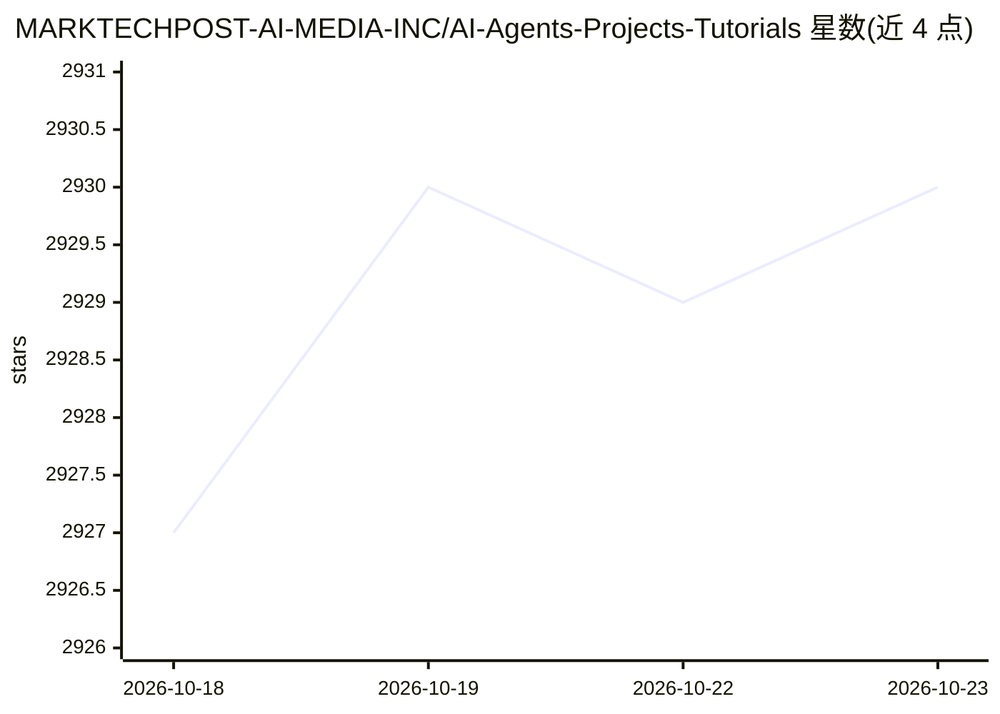

# MARKTECHPOST-AI-MEDIA-INC/AI-Agents-Projects-Tutorials

⭐ 2,930 · Jupyter Notebook · 推送 2026-10-22 · [GitHub](https://github.com/MARKTECHPOST-AI-MEDIA-INC/AI-Agents-Projects-Tutorials) · [官网](https://marktechpost.com/) · 组织维护

**Agentic AI 与 AI Agent 教程及代码实现的策展清单**

由 MARKTECHPOST 维护的 Agentic AI 教程聚合清单：以条目形式收录约 85 篇教程链接，主题覆盖多智能体系统、记忆架构、规划与推理循环、工具调用、强化学习、Agentic RAG、安全治理与评测等，多数条目标注配套代码与部分可在 Google Colab 中打开的 Notebook。仓库本身不提供可安装的软件或运行入口，内容以外部教程链接组织，无分类目录结构。面向寻找 agent 开发学习路径与参考实现的开发者。

## 筛选速览

| 维度 | 判定 | 备注 |
|---|---|---|
| AI 角色 | `ai-knowledge` | 知识聚合/清单类 |
| 许可风险 | `none` | — |
| 部署形态 | `None` |  |
| 模型依赖 | — | README 未给出锁定关系 |
| 硬件要求 | — | 无带数字的原话,不猜 |
| 安装摩擦 | `low` | 无编译、无系统依赖或容器化 |
| 成熟度 | — | 结构信号不足 |

## 能力要点

- 约 85 条 agent 教程条目，多数标注配套代码
- 主题覆盖多智能体、记忆、规划、推理循环、Agentic RAG、安全治理
- 部分条目附 Open In Colab 的 Notebook 入口

## 适用场景

- 系统性地查找 agent 开发各主题的教程与参考实现
- 跟随教程学习多智能体系统、记忆与工具调用等机制
- 在 Colab 中直接打开部分教程 Notebook 动手实践

## 场景标签

`精选清单` · 领域:学习与行业

## 证据(README 行号)

> L3: ### Agentic AI and Agents Tutorials/Implementations and Notebooks
> L45: ▶ Build a SuperClaude Framework Workflow with Commands, Agents, Modes, and Session Memory Codes TutorialOpen In Col

## 星数曲线

2026-10-18 2,927 → 2026-10-23 2,930（+3）

---
*卡片 v1 · prompt 1.4 · 生成 2026-10-21 · 置信度 high · 依据 README sha `90c3870ef416` · [字段定义](../../DATASET.md)*
