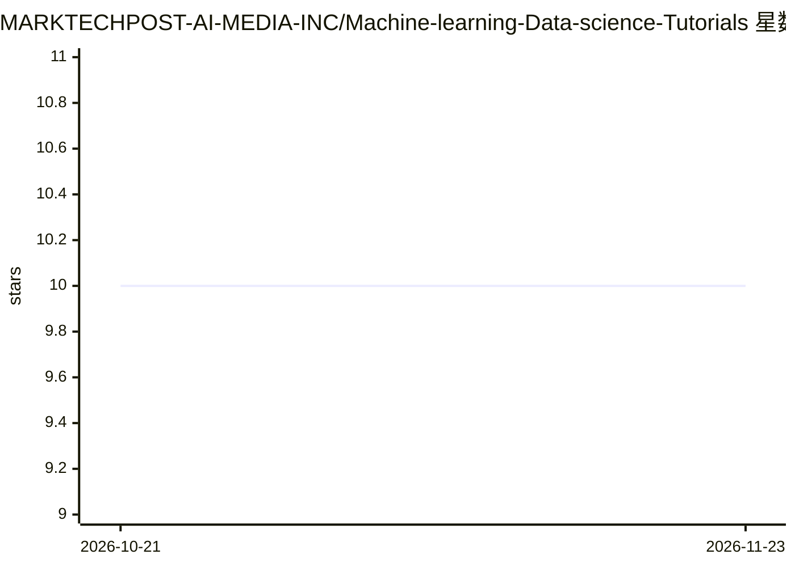

# MARKTECHPOST-AI-MEDIA-INC/Machine-learning-Data-science-Tutorials

⭐ 10 · 推送 2026-10-22 · [GitHub](https://github.com/MARKTECHPOST-AI-MEDIA-INC/Machine-learning-Data-science-Tutorials) · [官网](https://marktechpost.com/) · 组织维护

**机器学习与数据科学教程清单：含完整实现代码**

由 MarkTechPost 维护的教程索引仓库，逐条列出机器学习与数据科学项目的实现教程及配套代码链接，主题覆盖经典 ML、特征工程、流水线、深度学习、Transformer、联邦学习、MLOps、GPU 计算与可视化等。每条为指向外部教程与代码的条目，仓库本身不含安装或运行说明。适合需要按专题查找带代码实操教程的学习者与开发者。

## 筛选速览

| 维度 | 判定 | 备注 |
|---|---|---|
| AI 角色 | `ai-knowledge` | 知识聚合/清单类 |
| 许可风险 | `none` | — |
| 部署形态 | `None` |  |
| 模型依赖 | — | README 未给出锁定关系 |
| 硬件要求 | — | 无带数字的原话,不猜 |
| 安装摩擦 | `medium` | 含编译或系统依赖之一 |
| 成熟度 | — | 结构信号不足 |

## 能力要点

- 按条目组织的教学清单，每条附 Codes/Tutorial 链接
- 主题覆盖经典 ML、深度学习、联邦学习、MLOps、GPU 计算
- 多个条目提供 Google Colab 在线运行入口

## 适用场景

- 查找某个 ML 主题（如 LoRA 微调、SHAP 解释）的带代码教程
- 在 Colab 上跟做端到端机器学习流水线练习
- 按专题索引数据科学与 MLOps 工具的实操示例

## 场景标签

`教程课程` · 领域:学习与行业

## 证据(README 行号)

> L2: List of Machine Learning and Data Science Projects with Full Implementation codes
> L4: ▶ NVIDIA Nsight Python Tutorial: How to Profile GPU Kernels Codes Tutorial

## 星数曲线

2026-10-21 10 → 2026-11-23 10（+0）

---
*卡片 v1 · prompt 1.4 · 生成 2026-11-20 · 置信度 high · 依据 README sha `d159b309ff65` · [字段定义](../../DATASET.md)*
