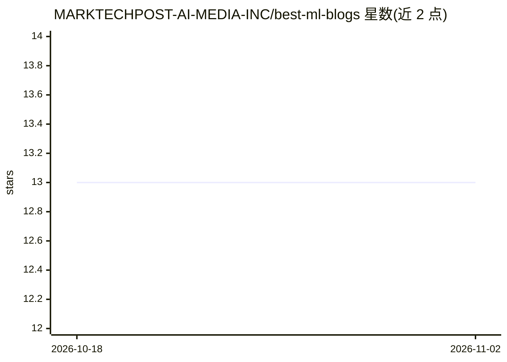

# MARKTECHPOST-AI-MEDIA-INC/best-ml-blogs

⭐ 13 · 推送 2025-12-22 · [GitHub](https://github.com/MARKTECHPOST-AI-MEDIA-INC/best-ml-blogs) · 组织维护

**机器学习技术博客与通讯的策展清单**

由 MarkTechPost 维护的机器学习技术博客和通讯聚合清单，按作者个人博客、大公司研究博客、大公司应用工程博客、大学研究博客和社区内容五类组织，收录从研究到部署方向的内容来源，面向希望跟踪研究进展或实用教程的读者。仓库提供贡献指南接受新增条目。清单本身不含安装或运行内容，仅以条目形式组织外部链接。

## 筛选速览

| 维度 | 判定 | 备注 |
|---|---|---|
| AI 角色 | `ai-knowledge` | 知识聚合/清单类 |
| 许可风险 | `none` | — |
| 部署形态 | `None` |  |
| 模型依赖 | — | README 未给出锁定关系 |
| 硬件要求 | — | 无带数字的原话,不猜 |
| 安装摩擦 | `low` | 无编译、无系统依赖或容器化 |
| 成熟度 | — | 结构信号不足 |

## 能力要点

- 按个人/大公司研究/大公司应用/大学/社区五类组织博客条目
- 覆盖研究到部署方向的技术博客与通讯
- 提供贡献指南接受社区补充条目

## 适用场景

- 查找值得长期跟踪的机器学习技术博客
- 按研究或应用方向筛选内容来源
- 发现大学与大公司的 AI 研究博客

## 场景标签

`精选清单` · 领域:学习与行业

## 证据(README 行号)

> L1: # List of Machine Learning Technical AI Blogs
> L2: This is a curated list of awesome machine learning technical blogs and newsletters from research to deployment. You 

## 星数曲线

2026-10-18 13 → 2026-11-02 13（+0）

---
*卡片 v1 · prompt 1.4 · 生成 2026-10-31 · 置信度 high · 依据 README sha `67bc6b9f902d` · [字段定义](../../DATASET.md)*
