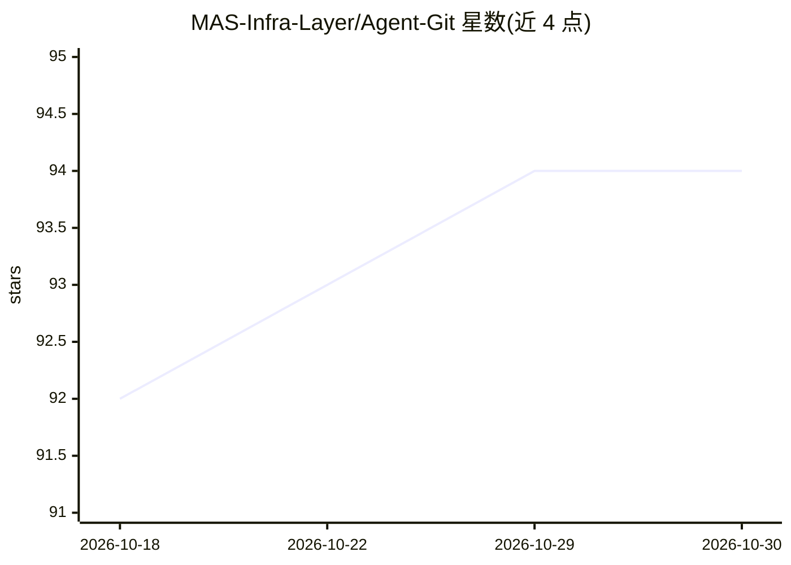

# MAS-Infra-Layer/Agent-Git

⭐ 94 · Python · Apache-2.0 · 推送 2026-04-21 · [GitHub](https://github.com/MAS-Infra-Layer/Agent-Git) · [官网](https://katadavidxd.github.io/Agent-Git/) · 组织维护 · 中文 README

**给 LangGraph/Agno agent 加 Git 式版本控制的 Python 库**

面向 LangGraph 与 Agno 等 agent 框架的基础设施库：为 AI 对话引入类 Git 操作，包括状态提交（Commit State）、状态回退（State Revert）、非破坏性分支（Branching）与工具逆向（撤销数据库写入、API 调用等副作用）。采用三层会话架构（External/Internal Session），状态持久化于 SQLite，重启后可恢复。提供 RollbackAgent 手动模式与 AgentService 简化 API 两种用法。当前以预发布 wheel 分发（agent_git_langchain 0.1.0），需另装 langchain/langgraph 并配置 OPENAI_API_KEY。

## 筛选速览

| 维度 | 判定 | 备注 |
|---|---|---|
| AI 角色 | `ai-ecosystem` | LLM/agent 周边工具 |
| 许可风险 | `permissive` | Apache-2.0 |
| 部署形态 | `library` | 以包/库形式分发 |
| 模型依赖 | — | README 未给出锁定关系 |
| 硬件要求 | — | 无带数字的原话,不猜 |
| 安装摩擦 | `low` | 无编译、无系统依赖或容器化 |
| 成熟度 | `idea` | |

## 能力要点

- 类 Git 的状态提交、回退与非破坏性分支
- 工具逆向：撤销数据库写入、API 调用等副作用
- SQLite 持久化存储，重启后可恢复会话
- 提供 RollbackAgent 与 AgentService 两种使用模式

## 适用场景

- 客服 agent 出错后回退到之前的检查点重试
- 同一上下文分多条并行路径做 A/B 测试
- 在执行高风险操作前建检查点以支持安全探索

## 场景标签

`Agent 记忆` · 领域:Agent 开发

## 证据(README 行号)

> L47: **Agent Git** is the first self-contained package that extends the standard Agentic framework, such as
> L55: Agent Git is a comprehensive version control framework for LangGraph agents that introduces

## 星数曲线

2026-10-18 92 → 2026-10-30 94（+2）

---
*卡片 v1 · prompt 1.4 · 生成 2026-10-23 · 置信度 high · 依据 README sha `9ab601f3fde8` · [字段定义](../../DATASET.md)*
