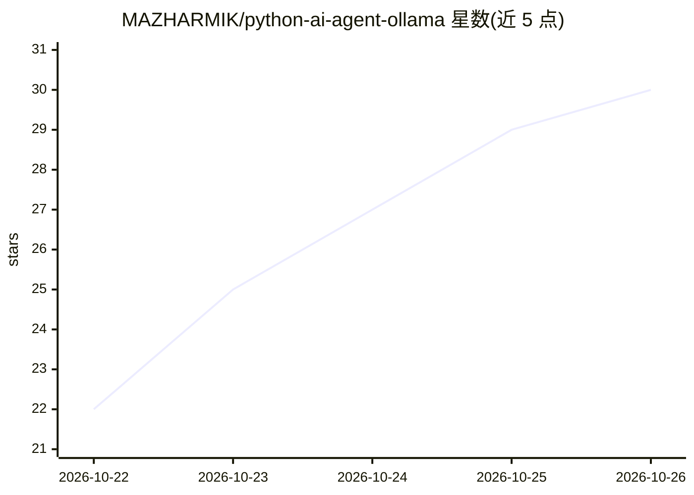

# MAZHARMIK/python-ai-agent-ollama

⭐ 30 · Python · MIT · 推送 2026-10-24 · [GitHub](https://github.com/MAZHARMIK/python-ai-agent-ollama) · [官网](https://www.youtube.com/watch?v=f0HBW-47wwU&list=PLGSKQmIKK2zQ) · 个人维护

**从零实现的本地 Python AI agent：Ollama 对话+多步工具调用**

不依赖框架、用纯 Python 从零实现的本地命令行 AI agent：通过 OpenAI 兼容 API 调用 Ollama 上的模型（如 qwen3:4b），无需付费 API key。功能包括对话记忆（每次调用回传全部历史）、系统提示、JSON Schema 描述的多步链式工具调用（MAX_STEPS=5 限制循环）、工具失败安全回传与调试跟踪。内置时间、天气（wttr.in）、用户城市三个演示工具，用户可在 tools.py 中按三步注册自己的工具。内存中的记忆退出即丢失，为 codestorywithMIK 视频系列的教学项目，声明仍在早期并将持续演进。

## 筛选速览

| 维度 | 判定 | 备注 |
|---|---|---|
| AI 角色 | `ai-native` | 本体是模型或模型工具 |
| 许可风险 | `permissive` | MIT |
| 部署形态 | `None` |  |
| 模型依赖 | local-ok | 支持本地模型 |
| 硬件要求 | — | 无带数字的原话,不猜 |
| 安装摩擦 | `low` | 无编译、无系统依赖或容器化 |
| 成熟度 | `idea` | |

## 能力要点

- 无框架、无付费 key，经 OpenAI 兼容 API 调用 Ollama 本地模型
- 对话记忆 + 系统提示 + JSON Schema 工具描述的多步链式调用（MAX_STEPS=5）
- 内置 3 个演示工具，三步即可在 tools.py 注册自定义工具
- DEBUG 开关输出逐步灰色的 agent 思考调试跟踪

## 适用场景

- 学习 AI agent 的工具调用与对话循环的底层实现
- 跟随视频系列逐步理解 tokens/embeddings/RAG 等 AI 基础
- 在本地无 API key 环境下实验小型 agent 并扩展自己的工具

## 场景标签

`教程课程` · 领域:学习与行业

## 证据(README 行号)

> L16: A **local AI agent built from scratch in Python**. It talks to a model running on Ollama through the OpenAI-compati
> L18: It remembers the conversation, follows a system prompt, and can use tools **in several steps**. For example, it fir
> L39: |🔧|**Tool calling**|Tools are described with JSON schema and run by our own code|

## 星数曲线

2026-10-22 22 → 2026-10-26 30（+8）

---
*卡片 v1 · prompt 1.4 · 生成 2026-10-26 · 置信度 high · 依据 README sha `3ff4a7777649` · [字段定义](../../DATASET.md)*
