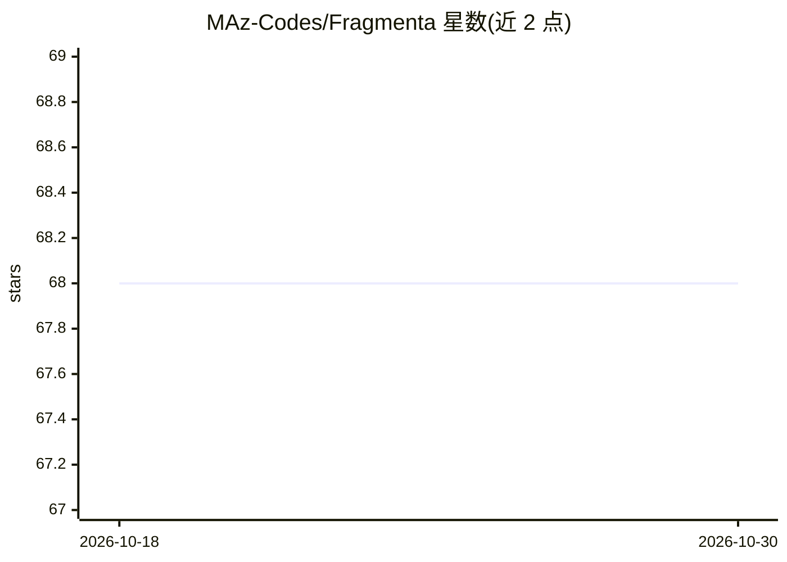

# MAz-Codes/Fragmenta

⭐ 68 · JavaScript · AGPL-3.0 · 推送 2026-10-29 · [GitHub](https://github.com/MAz-Codes/Fragmenta) · [官网](https://misaghazimi.com/fragmenta) · 个人维护

**面向音乐人的开源文本生成音频桌面应用：数据集、LoRA 训练到现场演奏**

基于 Stable Audio 3 的桌面应用，提供完整文本生成音频流程：Dataset Workbench 内置数据集构建（切片、DSP/AI 自动标注）、LoRA/DoRA/BoRA 训练（消费级 GPU 约 2.5GB 显存起）、最长 380 秒文本生成、4 通道现场演奏采样器（效果链、Ableton Link、MIDI learn）。安装后完全离线运行，需 Python 3.11、HuggingFace 账号下载受门控的模型权重；Medium 模型仅限 NVIDIA GPU 且需 Flash Attention 2，Apple Silicon 仅支持 M1 及以上。

## 筛选速览

| 维度 | 判定 | 备注 |
|---|---|---|
| AI 角色 | `ai-native` | 本体是模型或模型工具 |
| 许可风险 | `dual` | AGPL-3.0 |
| 部署形态 | `None` |  |
| 模型依赖 | — | README 未给出锁定关系 |
| 硬件要求 | — | 无带数字的原话,不猜 |
| 安装摩擦 | `low` | 无编译、无系统依赖或容器化 |
| 成熟度 | — | 结构信号不足 |

## 能力要点

- 数据集构建、LoRA 训练、生成、现场演奏一体化，无需写代码
- LoRA/DoRA/BoRA 训练，消费级 GPU 约 2.5GB 显存起，可叠加 4 个适配器
- 4 通道现场采样器：效果链、dBFS 表、Ableton Link 同步、MIDI learn
- 安装后完全离线运行，数据不离开本地设备

## 适用场景

- 用自己的音频数据训练 LoRA 并生成定制声音素材
- 实验音乐/声音艺术现场用 4 通道采样器实时演奏生成内容
- 为音频素材批量生成文本标注（BPM/调性/风格标签）

## 场景标签

`微调` · 领域:训练与推理

## 证据(README 行号)

> L15: Fragmenta is an open-source app that brings the complete generative AI text-to-audio pipeline to musicians: intuiti
> L26: - **Text-to-audio generation** — variable-length clips (up to 120s small / 380s medium), with CFG scale, inference 

## 星数曲线

2026-10-18 68 → 2026-10-30 68（+0）

---
*卡片 v1 · prompt 1.4 · 生成 2026-10-24 · 置信度 high · 依据 README sha `9a96ca51c458` · [字段定义](../../DATASET.md)*
