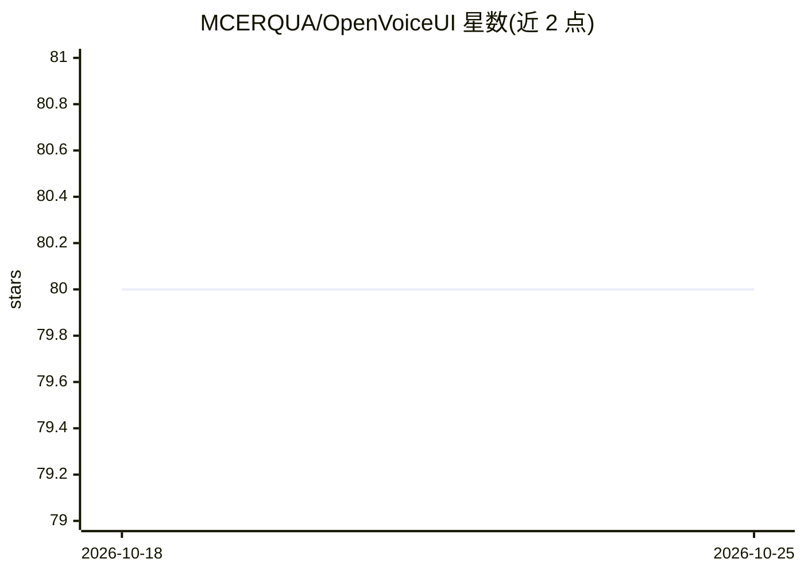

# MCERQUA/OpenVoiceUI

⭐ 80 · Python · MIT · 推送 2026-10-20 · [GitHub](https://github.com/MCERQUA/OpenVoiceUI) · [官网](https://openvoiceui.com) · 个人维护

**浏览器语音优先的自托管 AI 助手前端：接入任意 LLM 与 TTS**

基于 Flask 服务端与原生 JS 浏览器应用构建的自托管语音 AI 助手平台。用户在浏览器中通过语音（唤醒词/按键说话/打断）与运行于 OpenClaw 网关的 agent 对话，agent 可在对话中生成并实时更新交互式 HTML canvas 页面（仪表盘、工具、地图等），提供 OS 风格桌面管理已保存页面。支持多家 LLM 提供商经网关路由、九家 TTS 与多种 STT（含浏览器 Web Speech 免费默认）、Suno 音乐生成、Hugging Face/Gemini 图像生成，以及插件与 agent 技能系统。安装以 npx openvoiceui setup 配合 Docker Compose 为推荐路径，亦支持 Pinokio 与原生 Linux systemd 部署。MIT 许可，密钥与数据自持。

## 筛选速览

| 维度 | 判定 | 备注 |
|---|---|---|
| AI 角色 | `ai-native` | 本体是模型或模型工具 |
| 许可风险 | `permissive` | MIT |
| 部署形态 | `self-host` | docker 或自建部署 |
| 模型依赖 | locked-api |  |
| 硬件要求 | — | 无带数字的原话,不猜 |
| 安装摩擦 | `low` | 无编译、无系统依赖或容器化 |
| 成熟度 | — | 结构信号不足 |

## 能力要点

- 经 OpenClaw 网关接入 OpenAI/Anthropic/Groq/Gemini/Z.AI 等任意 LLM 提供商
- 九家 TTS 提供商（含本地免费的 Supertonic、Pocket TTS）与多家 STT（Web Speech/Deepgram/Groq Whisper 等）
- 对话中实时生成可交互 HTML canvas 页面，OS 风格桌面管理保存页面
- 插件目录、agent 技能捆绑、每 profile 切换 persona/语音/网关/LLM 设置

## 适用场景

- 在自己服务器上搭建可语音对话并展示实时页面/仪表盘的 AI 助手
- 通过 canvas 页面获得工具、地图、图片处理等可交互界面
- 为不同 agent profile 配置不同 LLM、语音与人格并切换使用
- 自托管生成音乐与图片的语音对话助理

## 场景标签

`AI 助手` `语音 Agent` · 领域:对话与助手

## 证据(README 行号)

> L19: OpenVoiceUI is the front end of a self-hosted AI agent. You talk to it in the browser; the agent
> L24: The agent itself runs in OpenClaw, an open-source agent gateway that
> L26: supplies tools, skills, memory and sub-agents. OpenVoiceUI is a Flask server plus a vanilla-JS

## 星数曲线

2026-10-18 80 → 2026-10-25 80（+0）

---
*卡片 v1 · prompt 1.4 · 生成 2026-10-24 · 置信度 mid · 依据 README sha `ef03d0e84134` · [字段定义](../../DATASET.md)*
