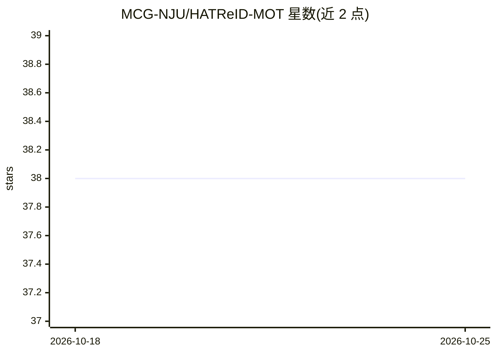

# MCG-NJU/HATReID-MOT

⭐ 38 · Python · Apache-2.0 · 推送 2026-07-23 · [GitHub](https://github.com/MCG-NJU/HATReID-MOT) · [官网](https://arxiv.org/abs/2503.12562) · 组织维护

**利用历史信息变换 ReID 特征的多目标跟踪算法官方实现**

ECCV 2026 论文 History-Aware Transformation of ReID Features for Multiple Object Tracking 的官方 PyTorch 实现。提出即插即用的 HAT 算法，在历史信息引导下为视频序列中的目标外观特征（ReID 特征）寻找更具判别性的子空间，以提升 ReID-based MOT 跟踪器的表现。仓库按不同跟踪框架组织为独立子项目，当前提供 HAT-MASA（纯外观特征匹配的零样本跟踪模型）与 HAT-SORT（基于流行 SORT 系代码库修改）两种实现。面向计算机视觉研究者使用，各子项目需独立运行。

## 筛选速览

| 维度 | 判定 | 备注 |
|---|---|---|
| AI 角色 | `ai-native` | 本体是模型或模型工具 |
| 许可风险 | `permissive` | Apache-2.0 |
| 部署形态 | `None` |  |
| 模型依赖 | — | README 未给出锁定关系 |
| 硬件要求 | — | 无带数字的原话,不猜 |
| 安装摩擦 | `low` | 无编译、无系统依赖或容器化 |
| 成熟度 | — | 结构信号不足 |

## 能力要点

- 即插即用的 HAT 算法，可应用于带 ReID/外观分支的任意 MOT 跟踪器
- 提供 HAT-MASA 与 HAT-SORT 两个子项目实现
- ECCV 2026 接收，arXiv 论文编号 2503.12562

## 适用场景

- 在现有 ReID-based MOT 跟踪器上引入 HAT 算法提升轨迹区分
- 复现论文中的多目标跟踪实验
- 研究外观特征子空间变换在跟踪中的作用

## 场景标签

 · 领域:计算机视觉/多目标跟踪

## 证据(README 行号)

> L3: This is the official PyTorch implementation of our paper:
> L11: **TL; DR.** We propose a plug-and-play **H**istory-**A**ware **T**ransformation algorithm for appearance features (

## 星数曲线

2026-10-18 38 → 2026-10-25 38（+0）

---
*卡片 v1 · prompt 1.4 · 生成 2026-10-25 · 置信度 high · 依据 README sha `2d5c21a41485` · [字段定义](../../DATASET.md)*
