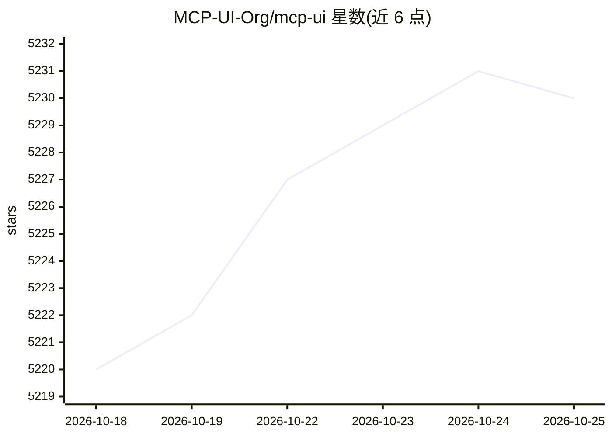

# MCP-UI-Org/mcp-ui

⭐ 5,232 · TypeScript · Apache-2.0 · 推送 2026-09-16 · [GitHub](https://github.com/MCP-UI-Org/mcp-ui) · [官网](https://mcpui.dev) · 个人维护

**实现 MCP Apps 标准的 UI SDK：让 MCP 工具返回可交互 Web 界面**

mcp-ui 是实现 MCP Apps 规范的多语言 SDK，覆盖 TypeScript(@mcp-ui/server 与 client)、Ruby(mcp_ui_server) 与 Python(mcp-ui-server)。服务端用 createUIResource 生成 ui:// 资源，通过 _meta.ui.resourceUri 将工具与 UI 关联；客户端用 AppRenderer/UIResourceRenderer 在宿主中渲染 HTML（沙箱 iframe），UI 可通过 onUIAction 事件触发工具调用。含平台适配器（如 ChatGPT Apps SDK）与 ui-inspector 调试工具，面向 MCP 服务器开发者和宿主开发者。

## 筛选速览

| 维度 | 判定 | 备注 |
|---|---|---|
| AI 角色 | `ai-ecosystem` | LLM/agent 周边工具 |
| 许可风险 | `permissive` | Apache-2.0 |
| 部署形态 | `library` | 以包/库形式分发 |
| 模型依赖 | — | README 未给出锁定关系 |
| 硬件要求 | — | 无带数字的原话,不猜 |
| 安装摩擦 | `low` | 无编译、无系统依赖或容器化 |
| 成熟度 | — | 结构信号不足 |

## 能力要点

- TypeScript/Ruby/Python 三语言 Server SDK，MCP Apps 标准实现
- AppRenderer/UIResourceRenderer 客户端组件，UI 在沙箱 iframe 中渲染
- UI Action 机制：界面事件可触发工具/提示/链接等动作
- 支持 MCP Apps 宿主（Claude/VSCode 等）并提供 Apps SDK 适配器（ChatGPT）

## 适用场景

- 给 MCP 服务器工具附加交互式 Web 界面
- 在自建 MCP 宿主中渲染工具返回的 UI 资源
- 用 ui-inspector 本地调试带 UI 的 MCP 服务器

## 场景标签

 · 领域:LLM 基础设施/MCP 工具链

## 证据(README 行号)

> L24: **`mcp-ui`** pioneered the concept of interactive UI over MCP, enabling rich web interfaces for AI tools. Alongside
> L36: * **`@mcp-ui/server` (TypeScript)**: Create UI resources with `createUIResource`. Works with `registerAppTool` and 

## 星数曲线

2026-10-18 5,220 → 2026-10-25 5,230（+10）

---
*卡片 v1 · prompt 1.4 · 生成 2026-10-20 · 置信度 high · 依据 README sha `f7f57f3b392d` · [字段定义](../../DATASET.md)*
