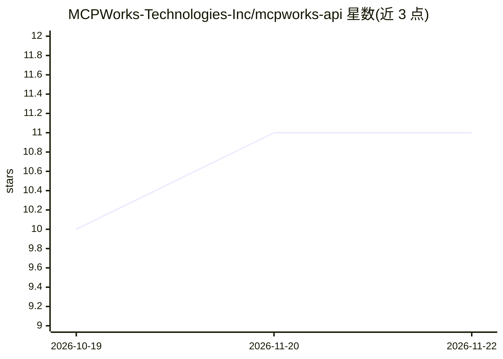

# MCPWorks-Technologies-Inc/mcpworks-api

⭐ 11 · Python · NOASSERTION · 推送 2026-06-03 · [GitHub](https://github.com/MCPWorks-Technologies-Inc/mcpworks-api) · [官网](https://mcpworks.io) · 组织维护

**自托管 Agent 运行时平台：沙箱执行代码以削减 token 消耗**

一个自托管的 AI agent 运行时平台，核心机制是让 AI 编写 Python/TypeScript 代码，在 nsjail 沙箱中执行并访问托管函数，数据不进入上下文窗口，仅返回结果，以降低工具调用带来的 token 成本。功能包括加密凭证存储（AES-256-GCM）、带调度与持久状态的 agent runtime、函数服务化与 MCP 端点、按 glob 模式的访问控制。通过 docker compose 自托管，亦提供云服务。许可为 BSL 1.1，非生产使用免费，2030 年转为 Apache 2.0。

## 筛选速览

| 维度 | 判定 | 备注 |
|---|---|---|
| AI 角色 | `ai-ecosystem` | LLM/agent 周边工具 |
| 许可风险 | `none` | NOASSERTION |
| 部署形态 | `self-host` | docker 或自建部署 |
| 模型依赖 | — | README 未给出锁定关系 |
| 硬件要求 | — | 无带数字的原话,不猜 |
| 安装摩擦 | `low` | 无编译、无系统依赖或容器化 |
| 成熟度 | — | 结构信号不足 |

## 能力要点

- 代码在 nsjail 沙箱执行，数据不进入 AI 上下文，仅返回结果
- 凭证 AES-256-GCM 加密存储，服务端注入，不进入 prompt
- 每个命名空间提供独立 MCP 端点，兼容 MCP 客户端
- BYOAI：可接入任意 LLM provider

## 适用场景

- 为 MCP 客户端托管 Python/TypeScript 函数服务
- 运行带调度与持久状态的自治 agent
- 自托管部署并控制 agent 可调用的函数范围

## 场景标签

`Agent 框架` · 领域:Agent 开发

## 证据(README 行号)

> L39: The AI writes Python or TypeScript. MCPWorks executes it in an isolated sandbox with access to your functions. The 
> L48: |**Agent Runtime**|Autonomous agents with scheduling, persistent state, webhooks, and AI orchestration. BYOAI — use
> L51: |**Self-Hosted**|`docker compose up` with bundled PostgreSQL, Redis, and Caddy. No external dependencies.|

## 星数曲线

2026-10-19 10 → 2026-11-22 11（+1）

---
*卡片 v1 · prompt 1.4 · 生成 2026-11-20 · 置信度 high · 依据 README sha `c3ce41b8d040` · [字段定义](../../DATASET.md)*
