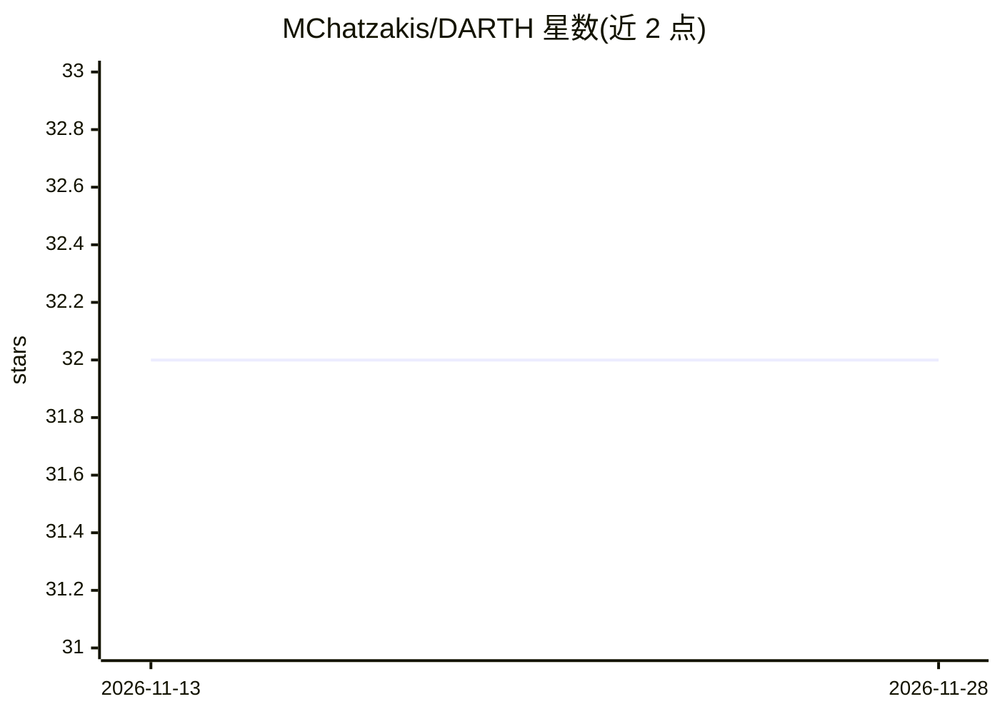

# MChatzakis/DARTH

⭐ 32 · C++ · MIT · 推送 2026-11-16 · [GitHub](https://github.com/MChatzakis/DARTH) · [官网](https://mchatzakis.github.io/declarative-recall/) · 个人维护

**向量检索研究代码：声明式召回目标下的学习型提前终止**

SIGMOD 2026 论文 DARTH 及扩展版 DARTH+ 的研究代码：在近似最近邻搜索（基于 FAISS 索引如 HNSW）之上，用户声明目标召回率，由训练的预测器（GBDT/LightGBM）按查询难度自适应估计停止时机，减少不必要的搜索工作量；DARTH+ 改进训练数据收集并加入查询维度感知特征，下界变体可给出召回率的概率下界。面向向量数据管理方向的科研人员，需自行编译 C++ pipeline，读取 .fvecs/.ivecs 格式数据集（SIFT100M、GIST、DEEP、Text2Image、GloVe）。README 提示代码近期重构中，遇问题需联系作者。

## 筛选速览

| 维度 | 判定 | 备注 |
|---|---|---|
| AI 角色 | `ai-ecosystem` | LLM/agent 周边工具 |
| 许可风险 | `permissive` | MIT |
| 部署形态 | `None` |  |
| 模型依赖 | — | README 未给出锁定关系 |
| 硬件要求 | — | 无带数字的原话,不猜 |
| 安装摩擦 | `medium` | 含编译或系统依赖之一 |
| 成熟度 | `idea` | |

## 能力要点

- 声明式召回：指定目标召回率，预测器逐查询估计停止点
- 自适应提前终止按查询难度调整搜索工作量
- DARTH+ 改进训练数据收集与查询维度感知预测特征
- 可选提供召回率的概率下界

## 适用场景

- 在 SIFT100M 等基准数据集上复现论文的提前终止实验
- 研究向量检索中召回率与搜索开销的权衡
- 以 FAISS HNSW 索引为基础测试学习型提前终止策略

## 场景标签

`向量数据库` `科研工具` · 领域:知识与检索

## 证据(README 行号)

> L11: DARTH and DARTH+ enable declarative recall for approximate nearest-neighbor search: specify a target recall, and a 
> L18: - DARTH: SIGMOD 26

## 星数曲线

2026-11-13 32 → 2026-11-28 32（+0）

---
*卡片 v1 · prompt 1.4 · 生成 2026-11-18 · 置信度 high · 依据 README sha `21ce90148ba4` · [字段定义](../../DATASET.md)*
