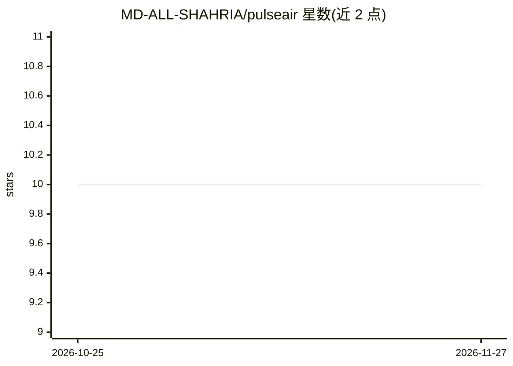

# MD-ALL-SHAHRIA/pulseair

⭐ 10 · Python · NOASSERTION · 推送 2026-10-04 · [GitHub](https://github.com/MD-ALL-SHAHRIA/pulseair) · [官网](https://github.com/MD-ALL-SHAHRIA/pulseair/blob/main/reports/final_results_summary.md) · 个人维护

**可穿戴空气质量风险预测的研究代码与评估工具库**

本科论文研究代码：面向 ESP32 空气质量颈环设备的离线预测管线，包含 GAN 增强训练、persistence 基线对照、滚动起点交叉验证、配对 bootstrap、Mondrian conformal 区间与 LLM 风险提示层（无 Gemini key 时回退规则模板）。附 pulsebench——数据集无关的不平衡时间序列模型评估库。部署候选为类加权 RandomForest，压缩导出 ONNX。数据不入库，需手动下载 Bangladesh 数据集。

## 筛选速览

| 维度 | 判定 | 备注 |
|---|---|---|
| AI 角色 | `ai-native` | 本体是模型或模型工具 |
| 许可风险 | `permissive` | NOASSERTION |
| 部署形态 | `library` | 以包/库形式分发 |
| 模型依赖 | — | README 未给出锁定关系 |
| 硬件要求 | — | 无带数字的原话,不猜 |
| 安装摩擦 | `low` | 无编译、无系统依赖或容器化 |
| 成熟度 | — | 结构信号不足 |

## 能力要点

- 每个结果都伴随零参数 persistence 基线与滚动起点 CV 交叉验证
- pulsebench：数据集无关的不平衡时间序列评估独立库
- CTGAN/SMOTE 消融实验与不合规干预淘汰规则
- 部署候选 RandomForest 压缩 8.6× 并导出 ONNX，conformal 覆盖率 Mondrian 校准

## 适用场景

- 复现可穿戴空气质量风险预测的完整实验流程
- 评估不平衡时间序列分类模型并对照 persistence 基线
- 对公开空气质量数据集做完整性审计

## 场景标签

`模型评测` `科研工具` · 领域:评测与运维

## 证据(README 行号)

> L9: Research code for an undergraduate thesis on **wearable air-quality forecasting**: a
> L27: |**What it is**|An off-device pipeline and a reusable evaluation toolkit for wearable air-quality risk forecasting|
> L31: |**Reusable toolkit**|`pulsebench` — the evaluation protocol as a standalone, dataset-agnostic library|

## 星数曲线

2026-10-25 10 → 2026-11-27 10（+0）

---
*卡片 v1 · prompt 1.4 · 生成 2026-11-20 · 置信度 high · 依据 README sha `f11ae4fccd26` · [字段定义](../../DATASET.md)*
