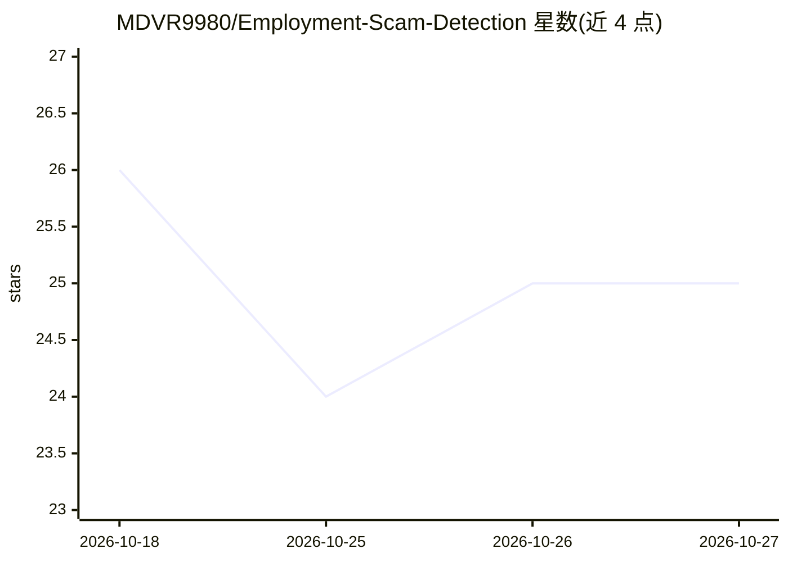

# MDVR9980/Employment-Scam-Detection

⭐ 25 · Jupyter Notebook · 推送 2025-11-27 · [GitHub](https://github.com/MDVR9980/Employment-Scam-Detection) · 个人维护

**用 NLP 与机器学习检测虚假招聘广告的项目（SVM ~98%）**

基于 EMSCAD 数据集的分类项目：对招聘文本做预处理（敏感模式替换为特殊 token、HTML 清洗、NLTK 词形还原），TF-IDF 加 1-2 元 N-gram 向量化，用 SMOTE 处理欺诈样本约 5% 的类不平衡，训练线性核 SVM 与 KNN 两个模型；以 Recall 为优先指标，SVM 报告约 98% 准确率、ROC-AUC 约 0.99。以 Jupyter Notebook 形式交付，克隆仓库并 pip 安装依赖后运行。README 列出 LSTM/BERT 与 Web API 部署为未来改进，当前未实现。

## 筛选速览

| 维度 | 判定 | 备注 |
|---|---|---|
| AI 角色 | `ai-native` | 本体是模型或模型工具 |
| 许可风险 | `none` | — |
| 部署形态 | `library` | 以包/库形式分发 |
| 模型依赖 | — | README 未给出锁定关系 |
| 硬件要求 | — | 无带数字的原话,不猜 |
| 安装摩擦 | `low` | 无编译、无系统依赖或容器化 |
| 成熟度 | — | 结构信号不足 |

## 能力要点

- 敏感模式 token 替换（Email/URL/电话/金额）的文本特征工程
- SMOTE 处理约 5% 欺诈样本的类不平衡
- TF-IDF + 1-2 元 N-gram 向量化
- SVM 与 KNN 对比评估，以 Recall 为关键指标

## 适用场景

- 我想分析招聘描述文本并训练欺诈分类模型
- 我想学习 SMOTE 处理不平衡文本数据的流程
- 我想在 Jupyter 中复现 EMSCAD 数据集上的欺诈检测实验

## 场景标签

 · 领域:数据科学/文本分类

## 证据(README 行号)

> L3: An NLP-based Machine Learning project to detect fraudulent job advertisements. This project analyzes job description
> L26: ### 1. Advanced Preprocessing (NLP)

## 星数曲线

2026-10-18 26 → 2026-10-27 25（-1）

---
*卡片 v1 · prompt 1.4 · 生成 2026-10-27 · 置信度 high · 依据 README sha `513c40e82d15` · [字段定义](../../DATASET.md)*
