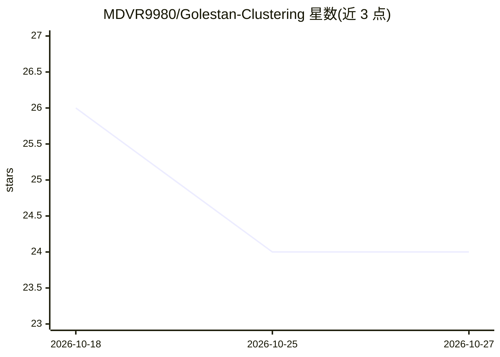

# MDVR9980/Golestan-Clustering

⭐ 24 · Jupyter Notebook · 推送 2025-12-18 · [GitHub](https://github.com/MDVR9980/Golestan-Clustering) · 个人维护

**对萨迪《蔷薇园》波斯语文本做无监督语义聚类的分析项目**

面向波斯语古典文学文本的分析项目：对萨迪《蔷薇园》中的轶事（Hikayats）进行无监督聚类，用 Hazm 做波斯语规范化/分词/词干化，结合针对古典文学的自定义停用词表；特征用 TF-IDF，降维用 LSA（TruncatedSVD），对比 K-Means（肘部法与轮廓系数选 k）与 DBSCAN（K-distance 图选 eps）两种算法，并用混淆矩阵热图将机器聚类与原书 8 章对齐。结果中 K-Means 最优 k 约 8，聚类与原章节存在重叠；DBSCAN 识别出离群轶事。通过 git clone 源码并 pip 安装依赖运行。

## 筛选速览

| 维度 | 判定 | 备注 |
|---|---|---|
| AI 角色 | `ai-native` | 本体是模型或模型工具 |
| 许可风险 | `none` | — |
| 部署形态 | `library` | 以包/库形式分发 |
| 模型依赖 | — | README 未给出锁定关系 |
| 硬件要求 | — | 无带数字的原话,不猜 |
| 安装摩擦 | `low` | 无编译、无系统依赖或容器化 |
| 成熟度 | — | 结构信号不足 |

## 能力要点

- Hazm 波斯语预处理 + 针对古典文学的自定义停用词表
- TF-IDF + LSA 降维后对比 K-Means 与 DBSCAN
- 肘部法/轮廓系数选 k，K-distance 图自动确定 eps
- 混淆矩阵热图评估聚类与原书章节的对齐程度

## 适用场景

- 验证古典波斯语文本能否按主题自动聚成接近原书章节的分组
- 比较 K-Means 与 DBSCAN 在文学文本上的聚类行为与离群检测
- 作为波斯语 NLP 预处理与 TF-IDF/LSA 流程的参考实现

## 场景标签

 · 领域:NLP/数字人文

## 证据(README 行号)

> L11: The goal is to group anecdotes (*Hikayats*) based on semantic similarity and compare the machine-generated clusters
> L21: * **Clustering Algorithms**:

## 星数曲线

2026-10-18 26 → 2026-10-27 24（-2）

---
*卡片 v1 · prompt 1.4 · 生成 2026-10-27 · 置信度 mid · 依据 README sha `c74427a9a5e5` · [字段定义](../../DATASET.md)*
