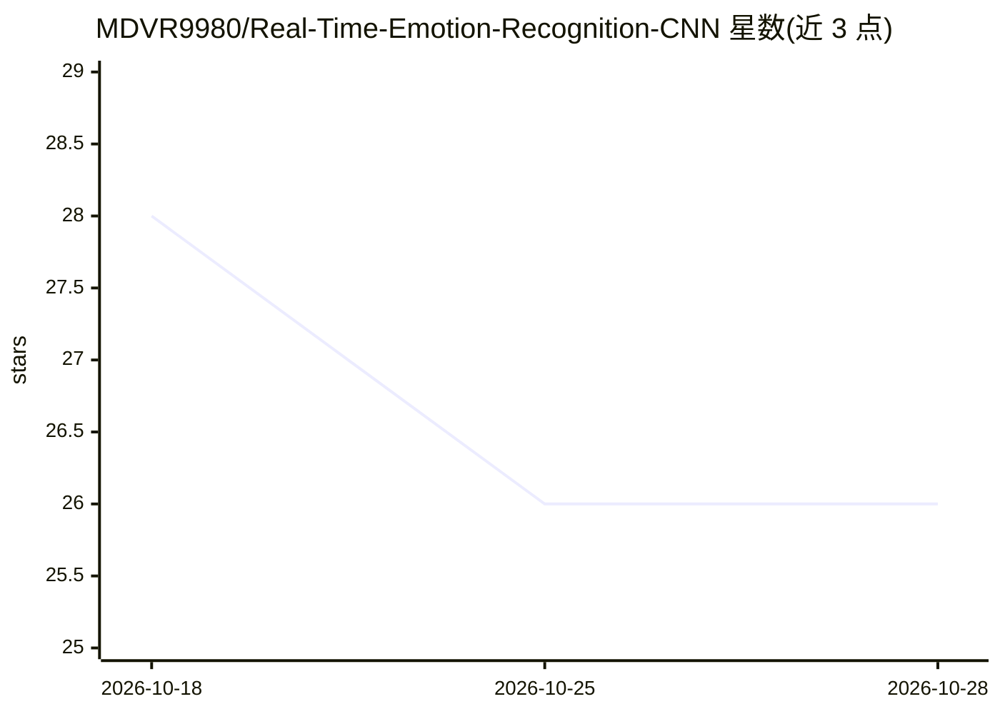

# MDVR9980/Real-Time-Emotion-Recognition-CNN

⭐ 26 · Jupyter Notebook · 推送 2026-01-28 · [GitHub](https://github.com/MDVR9980/Real-Time-Emotion-Recognition-CNN) · 个人维护

**CNN 实时摄像头表情识别工具，按情绪叠加滤镜**

基于 VGG 风格 CNN 的面部表情识别系统，在 FER-2013 数据集（48x48 灰度图）上训练，可从摄像头实时检测人脸并分类 7 种情绪，再按情绪对画面应用对应视觉滤镜（红/绿色调、褐色、高斯模糊、灰度、反色等）。技术栈为 TensorFlow/Keras 与 OpenCV（Haar Cascades 检测人脸），含预训练权重 emotion_model.h5，可用脚本直接运行摄像头演示，也可用 Jupyter Notebook 重新训练。训练/验证准确率约 61%/64%。

## 筛选速览

| 维度 | 判定 | 备注 |
|---|---|---|
| AI 角色 | `ai-native` | 本体是模型或模型工具 |
| 许可风险 | `none` | — |
| 部署形态 | `library` | 以包/库形式分发 |
| 模型依赖 | — | README 未给出锁定关系 |
| 硬件要求 | — | 无带数字的原话,不猜 |
| 安装摩擦 | `low` | 无编译、无系统依赖或容器化 |
| 成熟度 | — | 结构信号不足 |

## 能力要点

- 7 类情绪的实时摄像头识别（FER-2013 训练）
- 按检测情绪自动应用 8 种视觉滤镜
- 含预训练 h5 权重，脚本即可运行演示
- 4 个卷积块 CNN，使用数据增强/Dropout/BatchNorm

## 适用场景

- 我想在摄像头画面里实时看到自己的表情被识别并加滤镜
- 作为 FER-2013 表情识别的训练与复现参考工程
- 学习 CNN + OpenCV 实时推理的完整流程

## 场景标签

`图像视频处理` · 领域:感知与多模态

## 证据(README 行号)

> L3: A Computer Vision project that detects human emotions from facial expressions in real-time using a **Convolutional N
> L8: * **Real-Time Inference:** Detects faces and classifies emotions live using OpenCV and Haar Cascades.

## 星数曲线

2026-10-18 28 → 2026-10-28 26（-2）

---
*卡片 v1 · prompt 1.4 · 生成 2026-10-26 · 置信度 mid · 依据 README sha `d4a72c92038d` · [字段定义](../../DATASET.md)*
