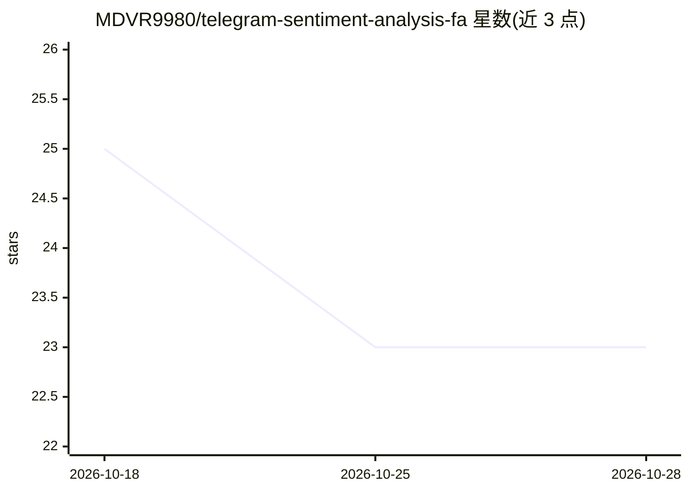

# MDVR9980/telegram-sentiment-analysis-fa

⭐ 23 · Jupyter Notebook · 推送 2025-12-16 · [GitHub](https://github.com/MDVR9980/telegram-sentiment-analysis-fa) · 个人维护

**用 Gemma 3 经 Ollama 对百万条波斯语 Telegram 帖子做五年情感分析**

面向波斯语 NLP 研究的分析项目：以 Telethon 抓取 5 个公共 Telegram 频道约 5 年（1399–1404 SH）近百万条帖子，经 Hazm 与正则做波斯语文本清洗归一化，再通过本地 Ollama 运行的 Google Gemma 3 27B（Q4_K_M 量化）配合定制波斯语系统提示，将帖子分类为 Happy/Sad/Angry/Anxious/Worried/Neutral 六类情绪，覆盖讽刺（طنز تلخ）等文化细微差别，输出时序趋势图与统计表。为高级 NLP 课程的学生项目，仓库含抓取脚本、清洗管线、Jupyter 流水线、结果数据集与结题报告 PDF。

## 筛选速览

| 维度 | 判定 | 备注 |
|---|---|---|
| AI 角色 | `ai-native` | 本体是模型或模型工具 |
| 许可风险 | `none` | — |
| 部署形态 | `library` | 以包/库形式分发 |
| 模型依赖 | local-ok | 支持本地模型 |
| 硬件要求 | `gpu-24g` | |
| 安装摩擦 | `low` | 无编译、无系统依赖或容器化 |
| 成熟度 | — | 结构信号不足 |

## 能力要点

- Telethon 抓取 5 个频道约百万条帖子（含元数据与反应）
- Hazm 波斯语文本清洗与字符归一化管线
- Gemma 3 27B（Q4_K_M）本地推理，输出 6 类波斯语情绪标签
- 生成 5 年情绪时序趋势与频道对比统计

## 适用场景

- 我想研究波斯语社交媒体的公众情绪长期趋势
- 我想复用波斯语文本清洗与 LLM 情感分类管线
- 我想基于现成结果数据集做社会文化分析

## 场景标签

`网页抓取` · 领域:效率与自动化

## 证据(README 行号)

> L12: The primary objective is to analyze public mood trends on **Telegram**, utilizing **Large Language Models (LLMs)** 
> L76: The core analysis is powered by **Google Gemma 3 (27B)** running locally via **Ollama**.

## 星数曲线

2026-10-18 25 → 2026-10-28 23（-2）

---
*卡片 v1 · prompt 1.4 · 生成 2026-10-27 · 置信度 mid · 依据 README sha `dface9813604` · [字段定义](../../DATASET.md)*
