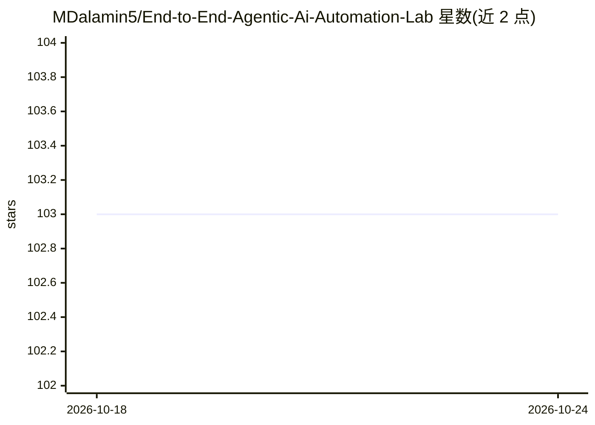

# MDalamin5/End-to-End-Agentic-Ai-Automation-Lab

⭐ 103 · Jupyter Notebook · MIT · 推送 2026-10-23 · [GitHub](https://github.com/MDalamin5/End-to-End-Agentic-Ai-Automation-Lab) · [官网](https://www.linkedin.com/in/mdalamin5/) · 个人维护

**多智能体与 RAG 的实操项目库：从入门到生产部署的工程示例集**

面向学习与工程实践的分模块代码仓库：以 LangChain、LangGraph、AutoGen、CrewAI 等框架演示从基础 LLM 调用到多智能体系统、生产级 RAG（BM25/Hybrid/HyDE/Reranking）、MCP 工具接入、n8n 低代码自动化、Unsloth/LoRA 微调与 vLLM 部署，并附 AI 面试官、ATS 等 4 个全栈端到端项目。各模块独立 requirements，需自配 OpenAI/Anthropic 等环境变量。

## 筛选速览

| 维度 | 判定 | 备注 |
|---|---|---|
| AI 角色 | `ai-knowledge` | 知识聚合/清单类 |
| 许可风险 | `permissive` | MIT |
| 部署形态 | `library` | 以包/库形式分发 |
| 模型依赖 | local-ok | 支持本地模型 |
| 硬件要求 | — | 无带数字的原话,不猜 |
| 安装摩擦 | `low` | 无编译、无系统依赖或容器化 |
| 成熟度 | — | 结构信号不足 |

## 能力要点

- 24 个递进模块覆盖 LangGraph/AutoGen/MCP/生产 RAG
- Unsloth+LoRA 微调与 vLLM 高吞吐推理部署示例
- n8n/LangFlow 零代码多智能体编排
- 含 AI 面试官、ATS、SynapseAI 等全栈项目

## 适用场景

- 按模块渐进学习多智能体与 RAG 工程实现
- 参考生产级 RAG 与 Guardrails 的落地写法
- 复用 MCP 集成与 n8n 自动化工作流模板

## 场景标签

`多智能体` `RAG` `Agent 框架` `教程课程` · 领域:Agent 开发

## 证据(README 行号)

> L19: Welcome to the **End-to-End Agentic AI Automation Lab**. This repository is a massive, hands-on engineering playboo
> L34: The lab is structured progressively. Click to expand each module to see the underlying projects:
> L36:  1️⃣ Foundations & Data Ingestion (Modules 01 - 02)

## 星数曲线

2026-10-18 103 → 2026-10-24 103（+0）

---
*卡片 v1 · prompt 1.4 · 生成 2026-10-23 · 置信度 high · 依据 README sha `9591644d8111` · [字段定义](../../DATASET.md)*
