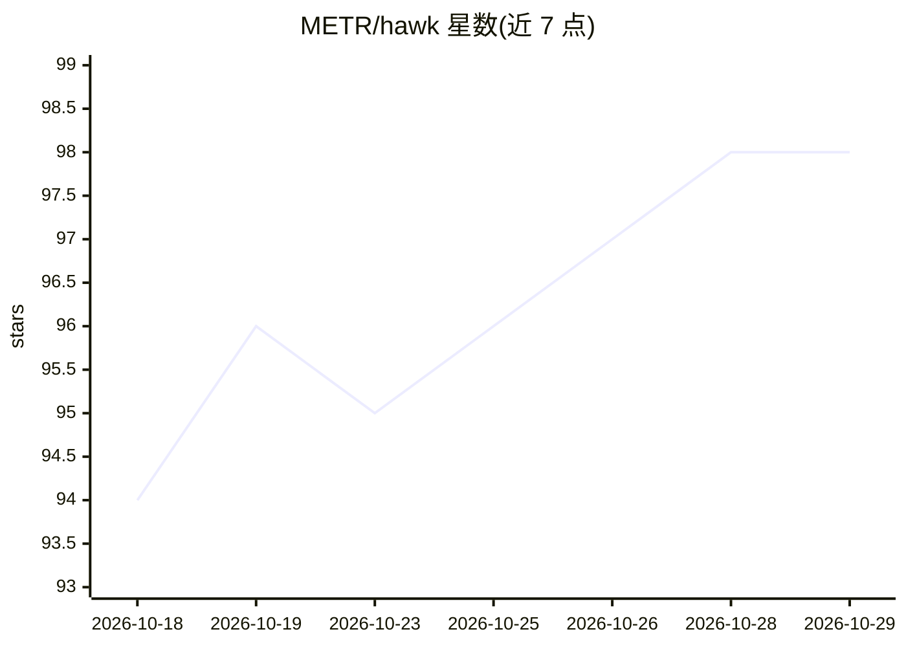

# METR/hawk

⭐ 98 · Python · MIT · 推送 2026-10-28 · [GitHub](https://github.com/METR/hawk) · [官网](https://hawk.metr.org) · 组织维护

**在 AWS 上规模化运行 Inspect AI 评测的系统**

METR 开源的 LLM 评测运行平台：用一份 YAML 定义任务、agent 与模型，自动运行全组合评测。部署层面通过 Pulumi 在 AWS 创建 EKS 评测 Pod、ECS API 服务、Aurora PostgreSQL 结果仓库、S3 日志存储等基础设施；内置 LLM 代理管理 OpenAI/Anthropic/Google Vertex 密钥。提供 CLI（PyPI 安装）、Python client、Web UI、实时日志与本地调试模式。面向已有或自建 Hawk 部署的评测团队。

## 筛选速览

| 维度 | 判定 | 备注 |
|---|---|---|
| AI 角色 | `ai-ecosystem` | LLM/agent 周边工具 |
| 许可风险 | `permissive` | MIT |
| 部署形态 | `library` | 以包/库形式分发 |
| 模型依赖 | — | README 未给出锁定关系 |
| 硬件要求 | — | 无带数字的原话,不猜 |
| 安装摩擦 | `low` | 无编译、无系统依赖或容器化 |
| 成熟度 | — | 结构信号不足 |

## 能力要点

- 一份 YAML 定义任务/agent/模型，自动运行全组合评测
- Pulumi 一键在 AWS 部署 EKS/ECS/Aurora/S3 等完整基础设施
- 内置 OpenAI/Anthropic/Google Vertex 的托管 LLM 代理
- hawk local 支持本机同配置调试，Web UI 支持结果筛选与 CSV 导出

## 适用场景

- 在自有 AWS 账号上部署可扩展的 LLM 评测基础设施
- 团队共享一个 Hawk 部署并提交、监控评测任务
- 对历史评测 transcript 运行 Scout 扫描分析

## 场景标签

`模型评测` · 领域:评测与运维

## 证据(README 行号)

> L67: - 📋 **One YAML, full grid.** Define tasks, agents, and models. Hawk runs every combination.
> L68: - ☸️ **Kubernetes-native.** Each eval gets its own pod and fresh virtualenv. Sandboxes run in separate pods with ne

## 星数曲线

2026-10-18 94 → 2026-10-29 98（+4）

---
*卡片 v1 · prompt 1.4 · 生成 2026-10-23 · 置信度 high · 依据 README sha `fb6285fb8a7c` · [字段定义](../../DATASET.md)*
