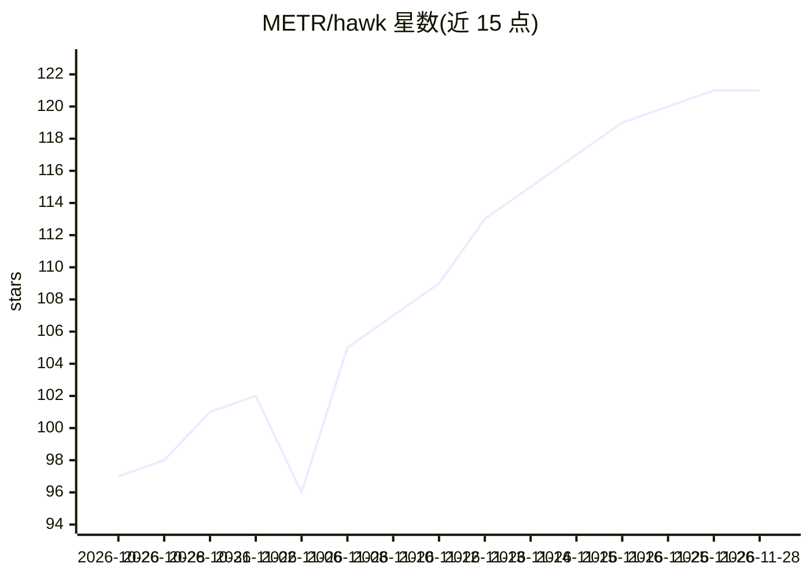

# METR/hawk

⭐ 121 · Python · MIT · 推送 2026-11-27 · [GitHub](https://github.com/METR/hawk) · [官网](https://hawk.metr.org) · 组织维护

**在 AWS 云端运行 Inspect AI 评测的基础设施**

由 METR 开发的评测运行平台：通过 Pulumi 在 AWS 上部署 EKS/ECS/Aurora/S3 等组件，以 Kubernetes pod 隔离运行 Inspect AI 评测任务。一个 eval-set YAML 定义任务、agent 与模型组合，平台运行全部排列；内置 LLM 代理管理 OpenAI、Anthropic、Google Vertex 的令牌刷新，结果写入 PostgreSQL 仓库并通过 Web UI 浏览、过滤与导出 CSV。提供 CLI、Python client、本地调试模式与 microVM 沙箱隔离选项。使用需 AWS 账户与域名。

## 筛选速览

| 维度 | 判定 | 备注 |
|---|---|---|
| AI 角色 | `ai-ecosystem` | LLM/agent 周边工具 |
| 许可风险 | `permissive` | MIT |
| 部署形态 | `library` | 以包/库形式分发 |
| 模型依赖 | — | README 未给出锁定关系 |
| 硬件要求 | — | 无带数字的原话,不猜 |
| 安装摩擦 | `low` | 无编译、无系统依赖或容器化 |
| 成熟度 | — | 结构信号不足 |

## 能力要点

- 单 YAML 定义任务/agent/模型，运行全部组合
- Kubernetes 原生：每个评测独立 pod 与全新 virtualenv，沙箱网络隔离
- 内置 LLM 代理，管理 OpenAI/Anthropic/Google Vertex 令牌刷新
- 结果入 PostgreSQL 数据仓库，Web UI 支持过滤、全文搜索与 CSV 导出

## 适用场景

- 在 AWS 上自建 Inspect AI 评测基础设施
- 按权限控制多人运行模型、查看日志与扫描评测集
- 大规模评测任务的实时日志监控与结果分析

## 场景标签

`模型评测` · 领域:评测与运维

## 证据(README 行号)

> L5:  Run evals at scale in AWS
> L68: - 📋 **One YAML, full grid.** Define tasks, agents, and models. Hawk runs every combination.
> L71: - 🔑 **Built-in LLM proxy.** Managed proxy for OpenAI, Anthropic, and Google Vertex with automatic token refresh. Br

## 星数曲线

2026-10-26 97 → 2026-11-28 121（+24）

---
*卡片 v1 · prompt 1.4 · 生成 2026-11-28 · 置信度 high · 依据 README sha `c6c5594ca959` · [字段定义](../../DATASET.md)*
