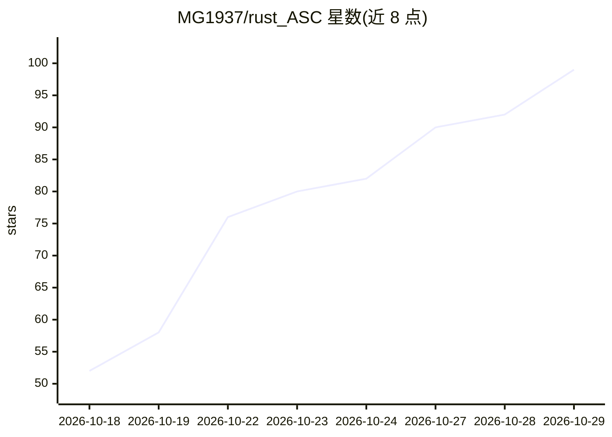

# MG1937/rust_ASC

⭐ 99 · Rust · Apache-2.0 · 推送 2026-10-28 · [GitHub](https://github.com/MG1937/rust_ASC) · 个人维护

**面向 Agent 的 Rust 版 Android APK/DEX 反编译器**

用 Rust 编写的无状态 Android APK 与 DEX 反编译工具，为 MG1937/ASC Python 版的 Rust 实现。直接查询编译产物，不做预处理、不建全局索引、无磁盘缓存，通过内存映射与并行跨 DEX 扫描实现毫秒级交叉引用搜索与单类反编译；支持多 DEX 与 DEX 041，可通过 radguard 公共 API 导出全 APK 伪代码。提供 CLI，并可运行 stdio MCP 服务器将命令暴露为工具供 Agent 调用。需 cargo 从源码构建，radguard 为 Git 子模块。README 含与 JADX 的基准对比数据。

## 筛选速览

| 维度 | 判定 | 备注 |
|---|---|---|
| AI 角色 | `ai-ecosystem` | LLM/agent 周边工具 |
| 许可风险 | `permissive` | Apache-2.0 |
| 部署形态 | `desktop` | 安装包/桌面程序 |
| 模型依赖 | — | README 未给出锁定关系 |
| 硬件要求 | — | 无带数字的原话,不猜 |
| 安装摩擦 | `medium` | 含编译或系统依赖之一 |
| 成熟度 | — | 结构信号不足 |

## 能力要点

- 无状态设计：无预处理、无索引构建、零磁盘缓存，毫秒级跨 DEX 引用搜索
- CLI 命令（getclass/findrefs/liststring 等）经 MCP 服务器暴露为 Agent 可调用工具
- 处理多 DEX APK 与 DEX 041 逻辑容器
- 经 radguard 公共 API 导出全 APK 伪代码

## 适用场景

- 安全研究员对大型 APK 做字符串/方法/字段的交叉引用搜索
- Agent 通过 MCP 工具批量分析 APK 而无需预处理
- 直接从 APK 定位并反编译单个类，导出全 APK 伪代码

## 场景标签

`网络安全` · 领域:学习与行业

## 证据(README 行号)

> L3: **rust_ASC is a stateless Android APK and DEX decompiler with millisecond cross-reference search, written in Rust.**
> L25: - Expose CLI queries as MCP tools over stdio.
> L91: `rust_ASC mcp` runs a stdio MCP server that exposes the CLI commands as tools: `getclass`, `listclass`, `listmethod

## 星数曲线

2026-10-18 52 → 2026-10-29 99（+47）

---
*卡片 v1 · prompt 1.4 · 生成 2026-10-24 · 置信度 high · 依据 README sha `757a45a57ea7` · [字段定义](../../DATASET.md)*
