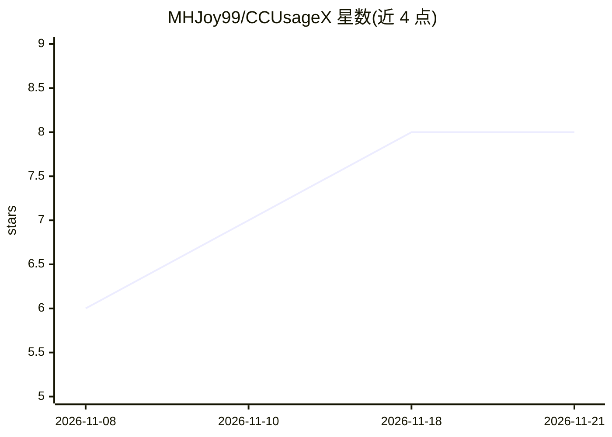

# MHJoy99/CCUsageX

⭐ 8 · JavaScript · MIT · 推送 2026-11-17 · [GitHub](https://github.com/MHJoy99/CCUsageX) · [官网](https://mhjoy99.github.io/CCUsageX/) · 个人维护

**本地仪表盘：从 Claude Code 日志统计每次提示的 token 与费用**

读取 Claude Code 写入 ~/.claude/projects 的转录文件，在本地网页（127.0.0.1:3020）展示每次提示触发的 API 请求、各类 token 明细（输入/输出/思考/缓存读写）、缓存命中率、响应速度及按 Anthropic 牌价折算的等价费用；另读取 /usage 报告展示 Pro/Max 订阅的 5 小时与 7 天限额。零依赖，仅需 Node.js 18+，数据不上传。支持 CSV 导出、实时活动流视图与 Windows Rainmeter 桌面小组件。

## 筛选速览

| 维度 | 判定 | 备注 |
|---|---|---|
| AI 角色 | `ai-ecosystem` | LLM/agent 周边工具 |
| 许可风险 | `permissive` | MIT |
| 部署形态 | `library` | 以包/库形式分发 |
| 模型依赖 | — | README 未给出锁定关系 |
| 硬件要求 | — | 无带数字的原话,不猜 |
| 安装摩擦 | `low` | 无编译、无系统依赖或容器化 |
| 成熟度 | — | 结构信号不足 |

## 能力要点

- 零依赖、本地运行，仅需 Node.js 18+
- 逐提示展示 token 明细、缓存节省与 API 等价费用
- 从 /usage 报告读取 Pro/Max 的 5 小时/7 天限额与重置时间
- 保留历史转录（Claude Code 默认 30 天后删除）

## 适用场景

- 查看自己 Claude Code 用量折算成 API 费用是多少
- 监控 Pro/Max 订阅限额的消耗进度与重置时间
- 按项目、会话、模型筛选并导出 CSV 用量报表

## 场景标签

`LLM 可观测性` · 领域:评测与运维

## 证据(README 行号)

> L6: A local, zero-dependency web dashboard that reads Claude Code's own logs and shows requests, models, tokens,
> L50: - **Plan usage limits.** Your 5-hour session and 7-day weekly limits on Pro and Max, with reset times, a pace
> L63: - **Filters and export.** Time range, model, project, session, main vs subagent, full-text search, CSV export.

## 星数曲线

2026-11-08 6 → 2026-11-21 8（+2）

---
*卡片 v1 · prompt 1.4 · 生成 2026-11-20 · 置信度 high · 依据 README sha `6b056fa2fd24` · [字段定义](../../DATASET.md)*
