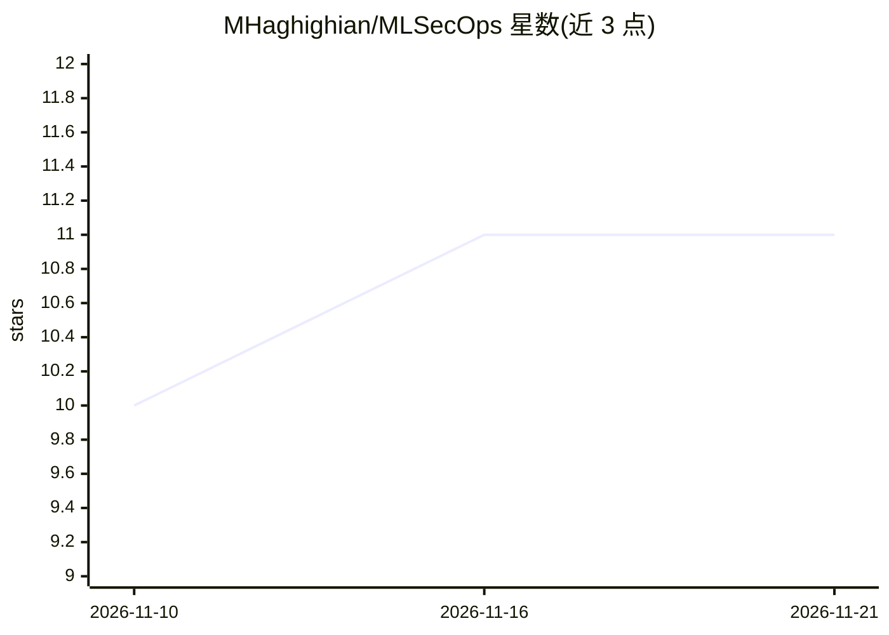

# MHaghighian/MLSecOps

⭐ 11 · Python · NOASSERTION · 推送 2026-11-11 · [GitHub](https://github.com/MHaghighian/MLSecOps) · [官网](https://mhaghighian.github.io/MLSecOps/) · 个人维护

**面向安全与 MLOps 团队的开源 AI 安全实践手册**

一份开源的 MLSecOps 参考指南，覆盖 ML 全生命周期的安全实践：数据与训练、部署、运行时监控、SOC 与治理，内容综合 OWASP AI Exchange、MITRE ATLAS、NIST AI RMF、ISO/IEC 42001、OpenSSF Secure MLOps 与 CSA MAESTRO 等框架。自有的操作化产出包括十个生命周期控制点、阻塞式发布决策、每次发布的 Evidence Pack 审计包，以及架构卡片、模板与 playbook 形式的实现参考。读者按角色路径选择阅读顺序，可通过文档站在线阅读或本地构建 DOCX。声明为独立开源指南，非 OWASP/NIST 官方标准。

## 筛选速览

| 维度 | 判定 | 备注 |
|---|---|---|
| AI 角色 | `ai-knowledge` | 知识聚合/清单类 |
| 许可风险 | `none` | NOASSERTION |
| 部署形态 | `library` | 以包/库形式分发 |
| 模型依赖 | — | README 未给出锁定关系 |
| 硬件要求 | — | 无带数字的原话,不猜 |
| 安装摩擦 | `low` | 无编译、无系统依赖或容器化 |
| 成熟度 | — | 结构信号不足 |

## 能力要点

- 十个生命周期控制点与阻塞式发布决策模型
- 每次发布生成可审计的 Evidence Pack，附机器可读 schemas 与 OPA 策略示例
- 覆盖 LLM、RAG、Agent 与 MCP 安全章节
- 提供按角色（高管/安全工程师/MLOps/LLM）的阅读路径

## 适用场景

- 为 AI 系统上线设计覆盖全生命周期的安全控制点
- 参考 LLM/RAG 网关、guardrails 与 prompt injection 防护的实践模式
- 在 CI/CD 中实施模型工件签名与供应链完整性检查
- 按 NIST/ISO/OWASP 框架整理 AI 治理与合规证据

## 场景标签

`网络安全` `MLOps` `教程课程` · 领域:学习与行业

## 证据(README 行号)

> L13: **MLSecOps Practical Reference Guide** is an open-source handbook for **AI security**, **machine learning security*
> L15: It covers **LLM security**, **RAG security**, **agentic AI**, **MCP**, **AI supply chain security**, and **DevSecOp
> L66: - **Implementation Reference** — architecture cards, templates, playbooks

## 星数曲线

2026-11-10 10 → 2026-11-21 11（+1）

---
*卡片 v1 · prompt 1.4 · 生成 2026-11-19 · 置信度 mid · 依据 README sha `5450611090e1` · [字段定义](../../DATASET.md)*
