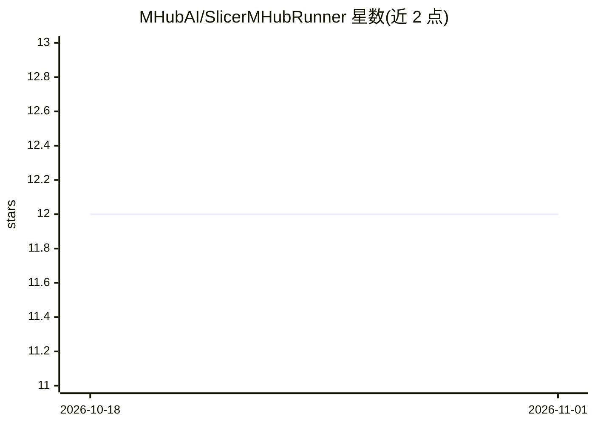

# MHubAI/SlicerMHubRunner

⭐ 12 · Python · MIT · 推送 2026-09-09 · [GitHub](https://github.com/MHubAI/SlicerMHubRunner) · [官网](https://mhub.ai) · 组织维护

**在 3D Slicer 中浏览并运行 MHub 医学影像模型**

3D Slicer 扩展，将 MHub.ai 上以容器形式打包的医学影像推理模型集成进 Slicer：提供模型搜索与筛选（类型、模态、商用状态）、下载/更新 Docker 镜像、选择输入影像（可复用 Slicer 已索引的 DICOM 数据库）、以容器工作流运行模型，并将支持的结果（DICOM 分割对象、JSON/CSV 表、模型特定表格与标注）加载回 Slicer 场景。每次运行记录 manifest（模型、输入标识、状态、输出）。要求 3D Slicer 5.12.x 与 Docker，GPU 模型需相应容器运行时配置；仓库自述处于活跃开发阶段，建议独立验证结果后再用于科研或临床流程。

## 筛选速览

| 维度 | 判定 | 备注 |
|---|---|---|
| AI 角色 | `ai-ecosystem` | LLM/agent 周边工具 |
| 许可风险 | `permissive` | MIT |
| 部署形态 | `None` |  |
| 模型依赖 | — | README 未给出锁定关系 |
| 硬件要求 | — | 无带数字的原话,不猜 |
| 安装摩擦 | `medium` | 含编译或系统依赖之一 |
| 成熟度 | `idea` | |

## 能力要点

- 搜索并浏览 MHub.ai 模型目录，管理 Docker 镜像下载与更新
- 复用 Slicer DICOM 数据库中的数据作为模型输入
- 以容器化工作流运行模型，结果（DICOM 分割、JSON/CSV 表）加载回场景
- 每次运行带 manifest 记录，可重开历史运行

## 适用场景

- 在 3D Slicer 内直接对医学影像执行 MHub 模型分割
- 查找并比较 MHub 目录中模型的模态与许可信息
- 复核历史运行并重新加载其输出结果

## 场景标签

`目标检测` · 领域:感知与多模态

## 证据(README 行号)

> L16: MHubRunner integrates containerized medical-imaging models from MHub.ai into 3D Slicer. It handles model discovery,
> L20: MHub.ai makes medical-imaging models more accessible by packaging complete inference pipelines in containers and st

## 星数曲线

2026-10-18 12 → 2026-11-01 12（+0）

---
*卡片 v1 · prompt 1.4 · 生成 2026-11-01 · 置信度 high · 依据 README sha `d5d2415b53ec` · [字段定义](../../DATASET.md)*
