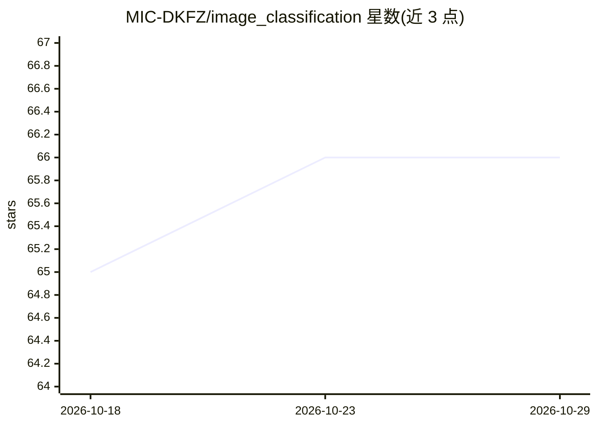

# MIC-DKFZ/image_classification

⭐ 66 · Python · Apache-2.0 · 推送 2026-10-02 · [GitHub](https://github.com/MIC-DKFZ/image_classification)

**PyTorch 图像分类/回归训练框架，面向快速实验**

GloViTa 是德国癌症研究中心（MIC-DKFZ）开源的 PyTorch 视觉任务训练框架，支持图像分类、图像回归、预计算特征训练、bag-of-features 多示例学习、视频 clip 级模型及早期帧级视频头。以 typed Python 配置替代 YAML，CLI 由 pydantic schema 通过 tyro 生成，训练管线按 dataset→transforms→dataloaders→model→PEFT→trainer 模块化组合，每次运行写入可复现的配置快照。提供 glovita_train/infer/extract_features/plot_umap 四个命令，内置通用图像数据集路径，支持 wandb/mlflow 实验跟踪。需在已有兼容 PyTorch 环境中 pip install -e . 安装。

## 筛选速览

| 维度 | 判定 | 备注 |
|---|---|---|
| AI 角色 | `ai-native` | 本体是模型或模型工具 |
| 许可风险 | `permissive` | Apache-2.0 |
| 部署形态 | `library` | 以包/库形式分发 |
| 模型依赖 | — | README 未给出锁定关系 |
| 硬件要求 | — | 无带数字的原话,不猜 |
| 安装摩擦 | `low` | 无编译、无系统依赖或容器化 |
| 成熟度 | — | 结构信号不足 |

## 能力要点

- 支持图像/3D体数据/时间序列/视频的分类与回归训练
- typed Python 配置 + tyro 生成 CLI，配置快照落盘保证可复现
- 四个安装命令：训练、推理、特征提取、UMAP 嵌入可视化
- 通用图像数据集路径支持 splits.json/子目录划分与多种标签来源

## 适用场景

- 用自定义图像数据集快速跑分类或回归实验
- 从零训练或微调视觉编码器（含 PEFT 参数高效微调）
- 提取模型特征并做 UMAP 可视化分析
- 用 wandb/mlflow 跟踪多组消融实验并复现配置

## 场景标签

`微调` · 领域:训练与推理

## 证据(README 行号)

> L1: A PyTorch framework for classification and regression of images, volumes, timeseries and videos including various fi
> L5: GloViTa is a PyTorch training stack for whole-sample vision prediction:

## 星数曲线

2026-10-18 65 → 2026-10-29 66（+1）

---
*卡片 v1 · prompt 1.4 · 生成 2026-10-24 · 置信度 high · 依据 README sha `098c0d0e540f` · [字段定义](../../DATASET.md)*
