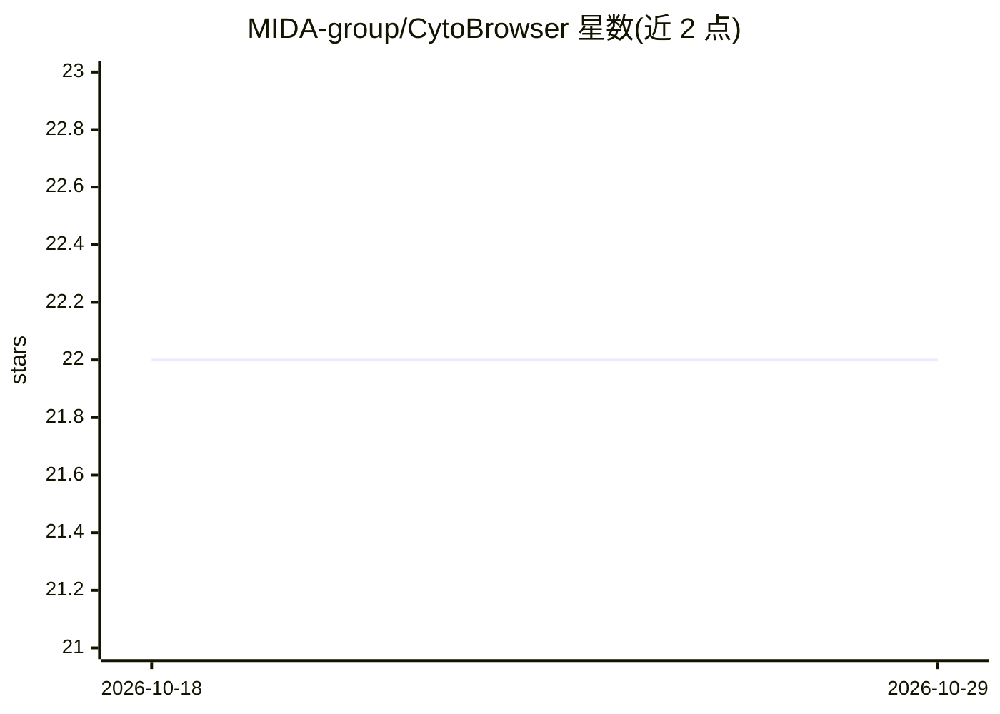

# MIDA-group/CytoBrowser

⭐ 22 · JavaScript · GPL-3.0 · 推送 2026-10-20 · [GitHub](https://github.com/MIDA-group/CytoBrowser) · 组织维护

**供科研人员协同查看与标注超大型显微图像的 Web 平台**

基于 JavaScript 与 Node.js 的浏览器端环境，用于超大型显微图像的协同可视化、评估与标注。TissUUmaps 面向细胞学的分支，支持 z-stack 焦层浏览、多用户共享视图与跟随、URL 编码当前视图、带类别标签与文本注释的点/区域标注，注释由服务端自动存储并可 JSON 导入导出。运行方式为 npx cytobrowser 或源码克隆后 npm install 并启动 Node 服务器；图像需为 OpenSeadragon 兼容格式（如 dzi）。由 VINNOVA 与瑞典研究理事会资助，附 F1000Research 2021 论文。

## 筛选速览

| 维度 | 判定 | 备注 |
|---|---|---|
| AI 角色 | `ai-enhanced` | 去掉 AI 部分产品仍成立 |
| 许可风险 | `viral` | GPL-3.0 |
| 部署形态 | `library` | 以包/库形式分发 |
| 模型依赖 | — | README 未给出锁定关系 |
| 硬件要求 | — | 无带数字的原话,不猜 |
| 安装摩擦 | `low` | 无编译、无系统依赖或容器化 |
| 成熟度 | — | 结构信号不足 |

## 能力要点

- 多用户共享视图与跟随（含切换图像与标注层时）
- z-stack 焦层处理，ctrl-scroll 调焦
- 点/区域标注，带类别标签与文本注释，服务端自动存储并支持 JSON 导入导出
- URL 编码当前视图与标注层，便于书签与分享

## 适用场景

- 细胞学/细胞病理学全切片图像的多人协同标注
- 在浏览器中浏览超大显微图像并保存/导出标注
- 通过书签链接分享特定视图与标注层给协作者

## 场景标签

`科研工具` · 领域:学习与行业

## 证据(README 行号)

> L2: CytoBrowser, a JavaScript and Node.js driven environment for fast and accessible collaborative online visualization,
> L6: Origintating as a fork[^1] of TissUUmaps aimed at Cytology

## 星数曲线

2026-10-18 22 → 2026-10-29 22（+0）

---
*卡片 v1 · prompt 1.4 · 生成 2026-10-28 · 置信度 mid · 依据 README sha `d7a3d5ba0f1a` · [字段定义](../../DATASET.md)*
