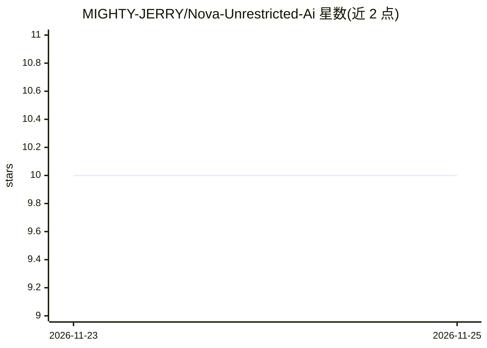

# MIGHTY-JERRY/Nova-Unrestricted-Ai

⭐ 10 · HTML · 推送 2026-10-15 · [GitHub](https://github.com/MIGHTY-JERRY/Nova-Unrestricted-Ai) · [官网](https://mighty-jerry.github.io/Nova-Unrestricted-Ai/) · 个人维护

**面向高级用户的浏览器端无过滤 LLM 聊天界面**

单文件 HTML 应用，通过 openrouter API 调用 LLM，主打无安全警告与道德说教过滤的直接交互模式。浏览器本地运行，无需安装或本地服务器，也提供 GitHub Pages 托管版本。API key 仅存于浏览器会话内存，聊天历史保存在浏览器本地。支持语音转文字输入、Markdown 渲染、图片/文件上传；文件上传会提高 token 用量。README 声明其为社交与技术实验，生成内容责任归用户。

## 筛选速览

| 维度 | 判定 | 备注 |
|---|---|---|
| AI 角色 | `ai-native` | 本体是模型或模型工具 |
| 许可风险 | `none` | — |
| 部署形态 | `None` |  |
| 模型依赖 | locked-api |  |
| 硬件要求 | — | 无带数字的原话,不猜 |
| 安装摩擦 | `low` | 无编译、无系统依赖或容器化 |
| 成熟度 | — | 结构信号不足 |

## 能力要点

- 单文件 index.html 应用，双击浏览器即用，零依赖
- 通过 openrouter API 接入 LLM，需用户自备 API key
- 语音转文字输入与图片/文件上传
- 聊天历史存于浏览器本地，key 不落库

## 适用场景

- 浏览器中直接与 LLM 对话而无需安装软件
- 本地保存聊天记录、key 不上传第三方数据库
- 上传图片进行多模态交互

## 场景标签

`聊天机器人` · 领域:对话与助手

## 证据(README 行号)

> L5: NOVA is a lightweight, high-aesthetic, and unrestricted AI chat interface devloped by Jashan with use of openrouter 
> L33: * **Unrestricted Mode:** Get direct answers without safety warnings or moralizing filters.

## 星数曲线

2026-11-23 10 → 2026-11-25 10（+0）

---
*卡片 v1 · prompt 1.4 · 生成 2026-11-23 · 置信度 high · 依据 README sha `8ef5b0552efb` · [字段定义](../../DATASET.md)*
