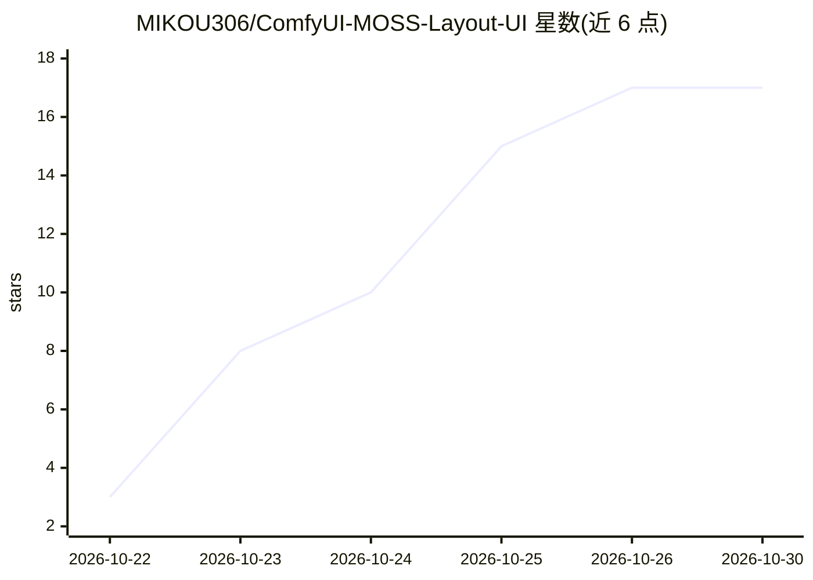

# MIKOU306/ComfyUI-MOSS-Layout-UI

⭐ 17 · JavaScript · MIT · 推送 2026-10-23 · [GitHub](https://github.com/MIKOU306/ComfyUI-MOSS-Layout-UI) · 个人维护 · 中文 README

**ComfyUI 排版插件：画布拖框生成 MOSS-Image 布局提示词 JSON**

面向 ComfyUI 与 MOSS-Image 用户的自定义节点插件，由三个节点组成：构图布画（画布拖框、编组、对齐、吸附）、元素管理（提示词与百分比坐标）、标准提示词（导入/合并/导出 JSON 并编译官方 summary/items 格式）。纯前端 DOM 面板加薄 Python 编译层，不装额外依赖，只用 ComfyUI 自带 torch/numpy/Pillow；布局以百分比坐标存储，换画布尺寸无需重排。限制：只支持轴对齐矩形，不支持 mask/多边形；生成尺寸必须等于画布尺寸；需 ComfyUI 新版节点 API（验证环境 0.41.0/前端 1.55.18/Python 3.12）。

## 筛选速览

| 维度 | 判定 | 备注 |
|---|---|---|
| AI 角色 | `ai-ecosystem` | LLM/agent 周边工具 |
| 许可风险 | `permissive` | MIT |
| 部署形态 | `None` |  |
| 模型依赖 | — | README 未给出锁定关系 |
| 硬件要求 | — | 无带数字的原话,不猜 |
| 安装摩擦 | `low` | 无编译、无系统依赖或容器化 |
| 成熟度 | `idea` | |

## 能力要点

- 三个节点：构图布画 / 元素管理 / 标准提示词，编译为 MOSS-Image 官方 summary/items JSON
- 百分比坐标存储布局，更换画布尺寸无需重排；编译结果与官方参考编译器逐值一致
- 多选、编组、位置锁定、吸附参考线、对齐分布、60 步撤销重做等画布编辑功能
- 内置电影海报、电商促销、杂志封面、人物介绍卡四套布局模板，支持自定义模板 JSON 导入导出

## 适用场景

- 为 MOSS-Image 海报生成可视化绘制布局而无需手写坐标 JSON
- 在 ComfyUI 工作流中管理多套排版并与宽高输入联动
- 导入/导出官方布局提示词草稿，衔接官方工具链

## 场景标签

`提示工程` `图像生成` · 领域:Agent 开发

## 证据(README 行号)

> L3: 给 MOSS-Image 用的三节点可视化排版插件：**在画布上拖框 → 编辑元素提示词 → 一键编译成模型能吃的 `summary/items` 紧凑 JSON**。不用手写坐标，换画布尺寸也不用重排。
> L99: `prompt` 输出的是 MOSS-Image 官方布局格式，直接接正向 `CLIPTextEncode.text`：
> L147: MIT. MOSS-Image itself is Apache-2.0 by OpenMOSS; this repo only contains the three layout nodes and does not ship

## 星数曲线

2026-10-22 3 → 2026-10-30 17（+14）

---
*卡片 v1 · prompt 1.4 · 生成 2026-10-30 · 置信度 high · 依据 README sha `6518a8fa4533` · [字段定义](../../DATASET.md)*
