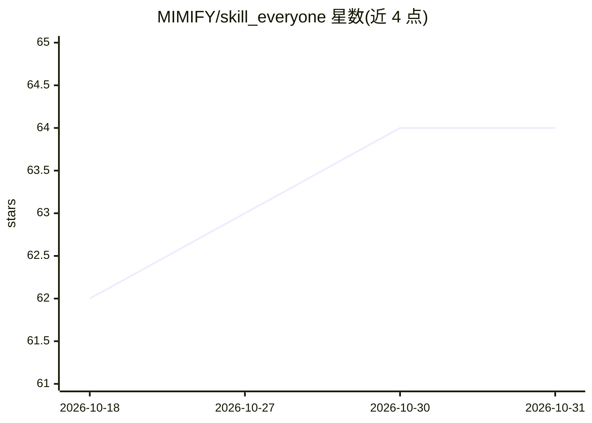

# MIMIFY/skill_everyone

⭐ 64 · HTML · MIT · 推送 2026-04-13 · [GitHub](https://github.com/MIMIFY/skill_everyone) · 个人维护 · 中文 README

**为 Claude Code 生成可对话角色 Skill 的角色扮演工具**

面向个人用户的 Claude Code Skill：输入任意小说/游戏/动漫角色名或原创人设素材（文字/图片/问答），经调研提炼后生成自包含的 SKILL.md 角色 Skill，支持沉浸对话与思维视角两种模式，并从依恋模式、防御机制、核心图式、需求层级、道德推理五个心理学维度建模角色行为逻辑。另附基于 Express 的本地 Web UI，调用同一 claude 凭证；生成的 Skill 符合 AgentSkills 标准可独立分发。冷门角色材料不足时工具会直接说明而不编造。

## 筛选速览

| 维度 | 判定 | 备注 |
|---|---|---|
| AI 角色 | `ai-native` | 本体是模型或模型工具 |
| 许可风险 | `permissive` | MIT |
| 部署形态 | `None` |  |
| 模型依赖 | locked-api |  |
| 硬件要求 | — | 无带数字的原话,不猜 |
| 安装摩擦 | `low` | 无编译、无系统依赖或容器化 |
| 成熟度 | — | 结构信号不足 |

## 能力要点

- 从任意角色名或原创素材生成可对话的 Claude Code Skill
- 5 维心理建模（依恋/防御/图式/需求/道德）构建角色回应逻辑
- 沉浸模式与视角模式两种对话形态
- 生成的 Skill 自包含、符合 AgentSkills 开放标准，可独立复制分发

## 适用场景

- 召唤小说/游戏/动漫角色进行陪伴式对话
- 用角色的价值观视角分析自己的真实问题
- 凭文字、图片或问答把原创人物（如逝去的宠物）建为可对话角色

## 场景标签

`聊天机器人` · 领域:对话与助手

## 证据(README 行号)

> L35: Summon 会调研、提炼、建模。然后把 TA 变成一个可以开口说话的人。
> L233: ~/.claude/skills/<slug>/

## 星数曲线

2026-10-18 62 → 2026-10-31 64（+2）

---
*卡片 v1 · prompt 1.4 · 生成 2026-10-24 · 置信度 high · 依据 README sha `cee468176d79` · [字段定义](../../DATASET.md)*
