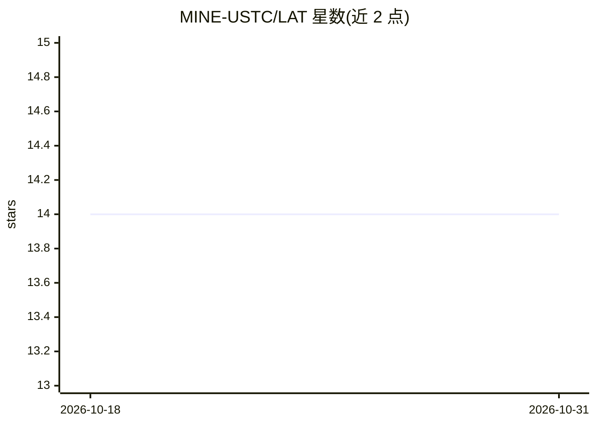

# MINE-USTC/LAT

⭐ 14 · Python · 推送 2025-12-01 · [GitHub](https://github.com/MINE-USTC/LAT) · 组织维护

**训练 VLM 统一推理与视觉归因的强化学习论文代码**

AAAI 2026 论文 Look as You Think 的官方代码：提出 Chain of Evidence 范式，通过两阶段（SFT 冷启动 + GRPO 强化学习）训练视觉语言模型，使思维链推理的每一步生成对齐的视觉证据归因，面向可验证的文档 RAG 场景。运行需自行下载 VISA 数据集，使用 LoRA 微调（冻结 ViT），训练后合并 LoRA 参数再评估。面向复现论文实验的研究者，代码基于 VLM-R1 与 VISA 开发。

## 筛选速览

| 维度 | 判定 | 备注 |
|---|---|---|
| AI 角色 | `ai-native` | 本体是模型或模型工具 |
| 许可风险 | `none` | — |
| 部署形态 | `library` | 以包/库形式分发 |
| 模型依赖 | — | README 未给出锁定关系 |
| 硬件要求 | — | 无带数字的原话,不猜 |
| 安装摩擦 | `low` | 无编译、无系统依赖或容器化 |
| 成熟度 | — | 结构信号不足 |

## 能力要点

- 两阶段 RL 框架：SFT 冷启动 + GRPO 强化学习
- 每个 CoT 推理步骤配对齐的视觉归因（Chain of Evidence）
- LoRA 微调语言模型、冻结 ViT 以降低显存占用
- 支持多图训练与 VISA 数据集评估

## 适用场景

- 复现论文的推理-归因统一训练流程
- 在 VISA 数据集上评估文档 RAG 的视觉证据归因
- 基于该框架继续研究多模态可验证推理

## 场景标签

`RAG` `多模态` `微调` `强化学习` · 领域:知识与检索

## 证据(README 行号)

> L3: This is the official code of the paper **Look as You Think: Unifying Reasoning and Visual Evidence Attribution for V
> L7: **TL;DR**: In this paper, we introduce the **Chain of Evidence (CoE)** paradigm, which models stepwise inference by 

## 星数曲线

2026-10-18 14 → 2026-10-31 14（+0）

---
*卡片 v1 · prompt 1.4 · 生成 2026-10-31 · 置信度 mid · 依据 README sha `fee866fd2399` · [字段定义](../../DATASET.md)*
