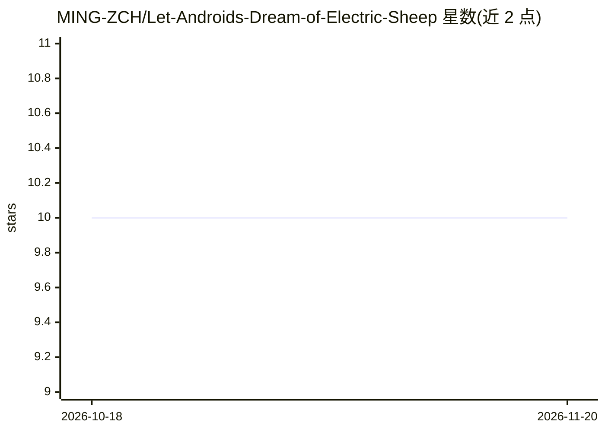

# MING-ZCH/Let-Androids-Dream-of-Electric-Sheep

⭐ 10 · Jupyter Notebook · MIT · 推送 2026-01-07 · [GitHub](https://github.com/MING-ZCH/Let-Androids-Dream-of-Electric-Sheep) · [官网](https://arxiv.org/abs/2505.17019v2) · 个人维护

**图像隐喻含义理解与推理的三阶段框架（研究项目）**

LAD 是一个图像含义理解与推理框架，针对图像隐喻理解中的上下文缺失问题，采用三阶段流程：Perception 将视觉信息转为多层文本表示，Search 迭代检索整合跨领域知识（含自建搜索与网络搜索），Reasoning 通过显式推理生成图像含义解释。论文报告配合 GPT-4o-mini 在英文图像含义基准上取得领先表现，并提供 MCQ 与自建的 Open-Style Question 评测方法。代码与数据集已发布，属研究用途，README 未给出完整安装步骤。

## 筛选速览

| 维度 | 判定 | 备注 |
|---|---|---|
| AI 角色 | `ai-native` | 本体是模型或模型工具 |
| 许可风险 | `permissive` | MIT |
| 部署形态 | `None` |  |
| 模型依赖 | — | README 未给出锁定关系 |
| 硬件要求 | — | 无带数字的原话,不猜 |
| 安装摩擦 | `low` | 无编译、无系统依赖或容器化 |
| 成熟度 | — | 结构信号不足 |

## 能力要点

- 三阶段框架：Perception / Search / Reasoning
- MCQ 之外提出 Open-Style Question 开放式评测方法（GPT-4o 作评测器）
- 支持 ModelSearch 与 WebSearch 两种知识检索路径
- 代码与数据集已随论文发布（arXiv:2505.17019）

## 适用场景

- 对含隐喻/文化含义的图像做含义解释与推理
- 在图像含义基准上评测多模态大模型表现
- 作为视觉问答与视觉推理任务的框架参考

## 场景标签

`多模态` `模型评测` · 领域:评测与运维

## 证据(README 行号)

> L14: Inspired by the human cognitive process, we propose ***Let Androids Dream (LAD)***, a novel framework for image imp
> L15: LAD addresses contextual missing through the three-stage framework: (1) **Perception**: converting visual informati
> L16: Our framework with the lightweight GPT-4o-mini model achieves SOTA performance compared to 15+ MLLMs on English ima

## 星数曲线

2026-10-18 10 → 2026-11-20 10（+0）

---
*卡片 v1 · prompt 1.4 · 生成 2026-11-20 · 置信度 high · 依据 README sha `6b2a58f39359` · [字段定义](../../DATASET.md)*
