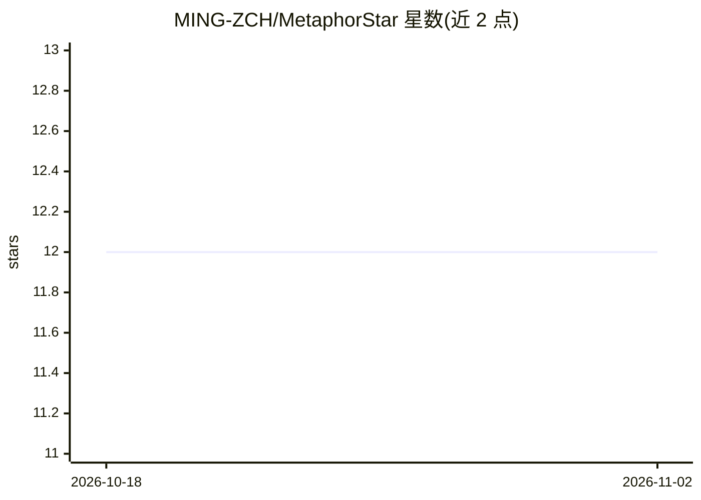

# MING-ZCH/MetaphorStar

⭐ 12 · Python · Apache-2.0 · 推送 2026-05-15 · [GitHub](https://github.com/MING-ZCH/MetaphorStar) · [官网](https://arxiv.org/abs/2602.10575) · 个人维护

**图像隐喻理解的视觉强化学习框架：数据集、基准与模型**

面向多模态大模型图像隐喻理解的研究型框架，包含三个部分：TFQ-Data 训练数据集（1,434 张图像、14,099 道真假判断题，由 GPT-4.1 基于 II-Bench 图像生成）、TFQ-Bench 评测集（Lite 版与训练集严格不重叠）、以及 TFQ-GRPO 视觉强化学习算法（结构化输出 <think>/<answer>、准确性+格式复合奖励、组相对策略优化）。发布 3B/7B/32B 三个基于该框架训练的模型及完整代码，模型与数据托管于 Hugging Face。供从事视觉推理与多模态 RL 研究的人员使用。

## 筛选速览

| 维度 | 判定 | 备注 |
|---|---|---|
| AI 角色 | `ai-native` | 本体是模型或模型工具 |
| 许可风险 | `permissive` | Apache-2.0 |
| 部署形态 | `None` |  |
| 模型依赖 | — | README 未给出锁定关系 |
| 硬件要求 | — | 无带数字的原话,不猜 |
| 安装摩擦 | `low` | 无编译、无系统依赖或容器化 |
| 成熟度 | — | 结构信号不足 |

## 能力要点

- TFQ 范式：将图像隐喻理解形式化为可验证的真假判断题，每图 5-10 题
- TFQ-GRPO：结构化输出约束与准确性/格式双奖励的组相对策略优化
- TFQ-Data 含 14,099 题训练集，TFQ-Bench-Lite 与训练集严格不重叠
- 开源 3B/7B/32B 模型、训练/评测数据集与完整代码

## 适用场景

- 训练或微调多模态模型以理解图像中的隐喻与深层含义
- 在图像隐喻基准上评测自己的多模态模型
- 复现论文中的视觉强化学习实验与消融分析

## 场景标签

`模型评测` `多模态` `强化学习` · 领域:评测与运维

## 证据(README 行号)

> L42: Metaphorical comprehension in images remains a critical challenge for Nowadays AI systems. While Multimodal Large L
> L228: We release a series of models trained with our framework.

## 星数曲线

2026-10-18 12 → 2026-11-02 12（+0）

---
*卡片 v1 · prompt 1.4 · 生成 2026-11-01 · 置信度 high · 依据 README sha `98132ba75e23` · [字段定义](../../DATASET.md)*
