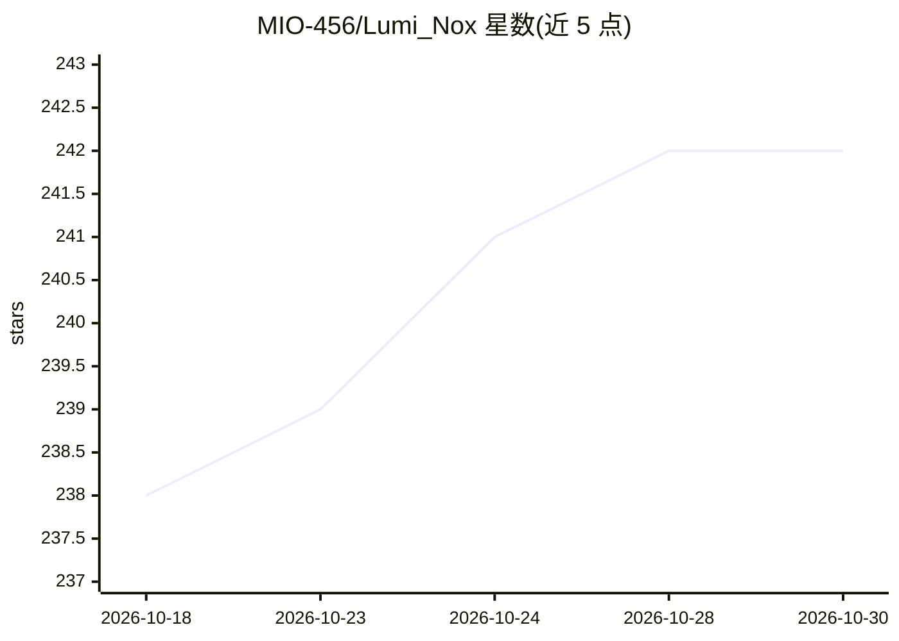

# MIO-456/Lumi_Nox

⭐ 242 · Python · MIT · 推送 2026-08-14 · [GitHub](https://github.com/MIO-456/Lumi_Nox) · [官网](https://space.bilibili.com/544387533) · 个人维护 · 中文 README

**双 AI 虚拟主播联合直播的实时引擎与编排系统**

开源核心（MIT）的双角色 AI VTuber 直播引擎：两个角色各自运行端到端语音对话会话（豆包 SC2.0 websocket），通过发言调度器、@提及路由与单一发言权仲裁实现双人同台实时对话、回应观众弹幕、SQLite 长期记忆与观众记忆衰减，并内置 Buckshot Roulette、Terraria、Kingdom Rush 等游戏桥接与 LLM 策略层。TTS/ASR 用 DashScope（CosyVoice/fun-asr），LLM 脑接受任意 OpenAI 兼容端点。main.py 提供零依赖演示；完整运行需自带 API key、语音 ID、Live2D 模型与游戏本体，人设、运营数据等部分闭源，非开箱即用产品。

## 筛选速览

| 维度 | 判定 | 备注 |
|---|---|---|
| AI 角色 | `ai-native` | 本体是模型或模型工具 |
| 许可风险 | `permissive` | MIT |
| 部署形态 | `library` | 以包/库形式分发 |
| 模型依赖 | — | README 未给出锁定关系 |
| 硬件要求 | — | 无带数字的原话,不猜 |
| 安装摩擦 | `low` | 无编译、无系统依赖或容器化 |
| 成熟度 | — | 结构信号不足 |

## 能力要点

- 双角色并行语音会话与单一发言权仲裁（QUEUE/DROP/INTERRUPT）
- 基于 SQLite 的观众/自我长期记忆与时间衰减
- Terraria/Kingdom Rush 等游戏桥接：A* 寻路、逐波 LLM 策略、独立进程熵求解器
- 零依赖 main.py 演示真实调度与仲裁核心

## 适用场景

- 搭建两个 AI 角色同台互动的直播系统
- 研究多 agent 实时语音对话的编排与仲裁机制
- 让 AI 主播在直播中游玩并解说游戏

## 场景标签

`语音 Agent` `多智能体` · 领域:Agent 开发

## 证据(README 行号)

> L37: - **Realtime dual-session engine** (`realtime_chat.py`, `realtime_chat_protocol.py`)
> L38:  — each character runs on its own end-to-end speech-to-speech session (doubao
> L17: Lumi and Nox are two AI VTubers who host a livestream together. They hold a

## 星数曲线

2026-10-18 238 → 2026-10-30 242（+4）

---
*卡片 v1 · prompt 1.4 · 生成 2026-10-22 · 置信度 mid · 依据 README sha `03760721d9f1` · [字段定义](../../DATASET.md)*
