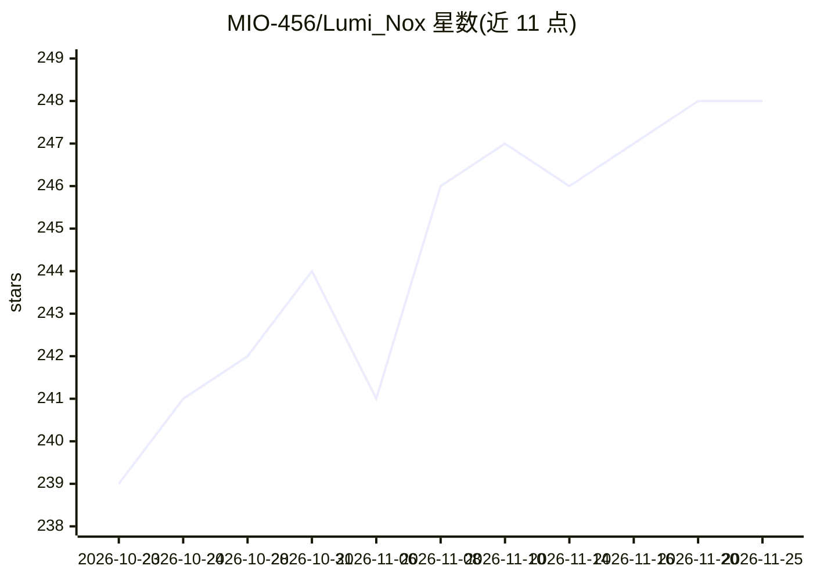

# MIO-456/Lumi_Nox

⭐ 248 · Python · MIT · 推送 2026-11-18 · [GitHub](https://github.com/MIO-456/Lumi_Nox) · [官网](https://space.bilibili.com/544387533) · 个人维护 · 中文 README

**双 AI VTuber 同台直播的实时编排引擎与中控**

开源核心（MIT）仓库，收录两位 AI 虚拟主播共同主持直播所需的工程模块：双角色点名路由与轮流接话调度、观众消息队列、语音输出仲裁（排队/丢弃/打断）、事件总线与状态机、节目流程中控（开场→聊天→五子棋→收尾）、SQLite 记忆存储、流式 TTS/ASR 与多款游戏桥接。提供无需 API Key 的网页演示路径（仅 Python 标准库），真实语音与模型需自行配置 OpenAI 风格的 /chat/completions 与 /audio/speech 接口。B 站弹幕与 OBS 自动控制尚未接入，私有角色资产与生产环境不在公开范围。

## 筛选速览

| 维度 | 判定 | 备注 |
|---|---|---|
| AI 角色 | `ai-native` | 本体是模型或模型工具 |
| 许可风险 | `permissive` | MIT |
| 部署形态 | `library` | 以包/库形式分发 |
| 模型依赖 | — | README 未给出锁定关系 |
| 硬件要求 | — | 无带数字的原话,不猜 |
| 安装摩擦 | `low` | 无编译、无系统依赖或容器化 |
| 成熟度 | — | 结构信号不足 |

## 能力要点

- 双角色发言调度：点名路由、轮换、跨角色历史镜像
- 语音输出仲裁器支持排队、丢弃与打断策略
- 无需密钥的网页演示路径仅依赖 Python 标准库
- 游戏模块覆盖泰拉瑞亚、王国保卫战、恶魔轮盘、Wordle、汉兜

## 适用场景

- 搭建两位 AI 主播共同主持的直播节目流程
- 研究多角色对话轮流接话与语音发言权仲裁的实现
- 参考项目中 AI 参与游戏（五子棋/泰拉瑞亚等）的桥接方式

## 场景标签

`多智能体` · 领域:Agent 开发

## 证据(README 行号)

> L17: Lumi 和 Nox 是共同主持直播的两位 AI 虚拟主播。项目围绕双角色对话、观众互动、语音、记忆和游戏展开：观众点名时由谁回应，两人怎样接话，游戏决策怎样与说话配合，都是这里关心的工程问题。
> L55: |怎样接入模型与语音|文本快脑、双角色实时语音会话、流式 TTS 与 ASR|dialogue/fast_brain.py、audio/realtime_chat.py、audio/lumi_tts.py、audio/lumi_a

## 星数曲线

2026-10-23 239 → 2026-11-25 248（+9）

---
*卡片 v1 · prompt 1.4 · 生成 2026-11-25 · 置信度 high · 依据 README sha `817e5b50707a` · [字段定义](../../DATASET.md)*
