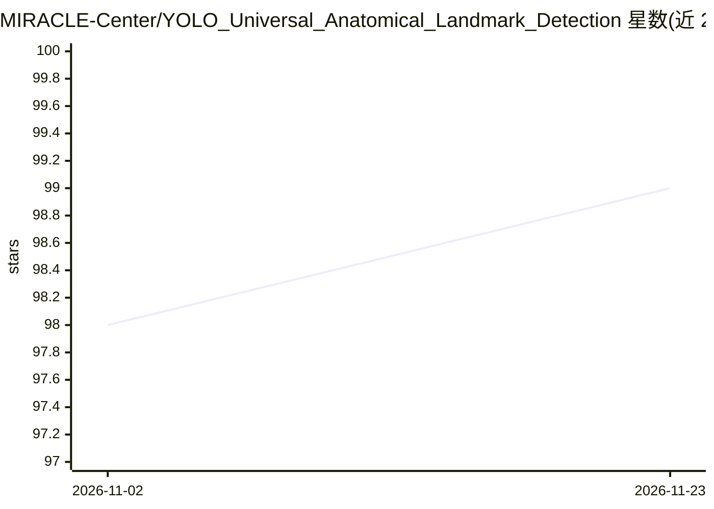

# MIRACLE-Center/YOLO_Universal_Anatomical_Landmark_Detection

⭐ 99 · Python · MIT · 推送 2026-11-02 · [GitHub](https://github.com/MIRACLE-Center/YOLO_Universal_Anatomical_Landmark_Detection) · 组织维护 · 中文 README

**医学影像解剖标志点检测的通用模型 PyTorch 实现**

MICCAI 2021 论文 You Only Learn Once 的官方 PyTorch 实现：在混合数据集上端到端训练一个通用模型，同时完成多个解剖区域的标志点检测。模型由局部网络（基于 universal U-Net 学习多域局部特征）与全局网络（并行复制的空洞卷积序列提取全局特征）组成，参数量少于标准卷积方案。在头部、手部、胸部三个 X 光数据集（1,588 张图、62 个标志点）上评估。提供训练/测试/评估脚本与预训练 checkpoint（Google Drive/蓝奏云）。要求 Linux、NVIDIA GPU、python3.5+。

## 筛选速览

| 维度 | 判定 | 备注 |
|---|---|---|
| AI 角色 | `ai-native` | 本体是模型或模型工具 |
| 许可风险 | `permissive` | MIT |
| 部署形态 | `library` | 以包/库形式分发 |
| 模型依赖 | — | README 未给出锁定关系 |
| 硬件要求 | — | 无带数字的原话,不猜 |
| 安装摩擦 | `low` | 无编译、无系统依赖或容器化 |
| 成熟度 | — | 结构信号不足 |

## 能力要点

- 混合数据集端到端训练的通用标志点检测模型（GU2Net）
- 局部 universal U-Net + 全局空洞卷积序列的双网络结构
- 在头部/手部/胸部三个 X 光数据集（62 个标志点）上评估
- 提供预训练 checkpoint 与训练/测试/评估完整命令

## 适用场景

- 在 X 光影像上检测头部/手部/胸部的解剖标志点
- 复现 MICCAI 2021 论文实验结果
- 作为多域学习医学影像检测的参考实现

## 场景标签

`目标检测` · 领域:感知与多模态

## 证据(README 行号)

> L3: PyTorch implementation for learning a universal model for anatomical landmark detection on mixed datasets.
> L12: Detecting anatomical landmarks in medical images plays an essential role in understanding the anatomy and planning 

## 星数曲线

2026-11-02 98 → 2026-11-23 99（+1）

---
*卡片 v1 · prompt 1.4 · 生成 2026-11-17 · 置信度 high · 依据 README sha `3d55471a6110` · [字段定义](../../DATASET.md)*
