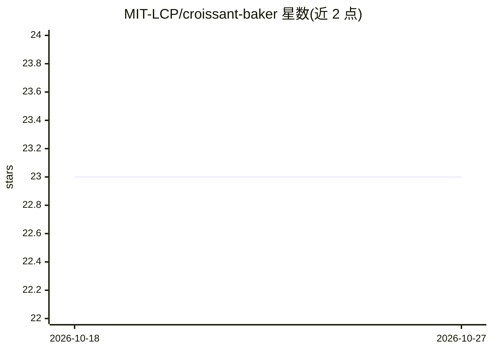

# MIT-LCP/croissant-baker

⭐ 23 · Python · MIT · 推送 2026-10-11 · [GitHub](https://github.com/MIT-LCP/croissant-baker) · [官网](https://lcp.mit.edu/croissant-baker/) · 组织维护

**从数据集文件目录自动生成 Croissant 元数据的命令行工具**

MIT-LCP 维护的 Python CLI 工具：扫描本地数据集目录，读取 20 余种格式（CSV/Parquet/FHIR/WFDB/DICOM/NIfTI/VCF/BAM/FASTQ 等，多为仅读文件头），自动推断类型并生成符合 Croissant 规范的 JSON-LD 元数据，供 PhysioNet、NeurIPS D&B 投稿等平台使用。支持 RAI 元数据、基因组样本标识默认不披露、mlcroissant 校验与 dry-run；另附带本地 MCP server 与 Agent Skill，stdio 通信、不发起网络请求。NeurIPS 2026 接收，MIT 许可。

## 筛选速览

| 维度 | 判定 | 备注 |
|---|---|---|
| AI 角色 | `ai-ecosystem` | LLM/agent 周边工具 |
| 许可风险 | `permissive` | MIT |
| 部署形态 | `library` | 以包/库形式分发 |
| 模型依赖 | — | README 未给出锁定关系 |
| 硬件要求 | — | 无带数字的原话,不猜 |
| 安装摩擦 | `low` | 无编译、无系统依赖或容器化 |
| 成熟度 | — | 结构信号不足 |

## 能力要点

- 覆盖 CSV/Parquet/FHIR/WFDB/DICOM/NIfTI/VCF/BAM 等 20 余种格式的自动类型推断
- 生成结果经 mlcroissant 按 Croissant 规范校验
- VCF/BCF/BAM 等基因组文件的样本标识默认不披露（需显式 --genomic-sample-ids）
- 附带本地 MCP server（dry_run/bake/validate 三工具）与 Agent Skill

## 适用场景

- 为要投稿 NeurIPS D&B 或发布到 PhysioNet 的数据集生成标准化元数据
- 让 AI agent 通过 MCP 调用，为本地数据集生成并校验 Croissant 元数据
- 批量描述含基因组/医学影像文件的多模态数据集目录

## 场景标签

 · 领域:ML 数据集元数据/科研数据管理

## 证据(README 行号)

> L15:  Automatically generate Croissant JSON-LD metadata for ML datasets — e.g. for PhysioNet, NeurIPS Datasets &amp; Ben
> L53: croissant-baker ships a local MCP server and
> L114: - **Validation** against the Croissant spec via `mlcroissant`

## 星数曲线

2026-10-18 23 → 2026-10-27 23（+0）

---
*卡片 v1 · prompt 1.4 · 生成 2026-10-27 · 置信度 high · 依据 README sha `09fc0c85eb6f` · [字段定义](../../DATASET.md)*
