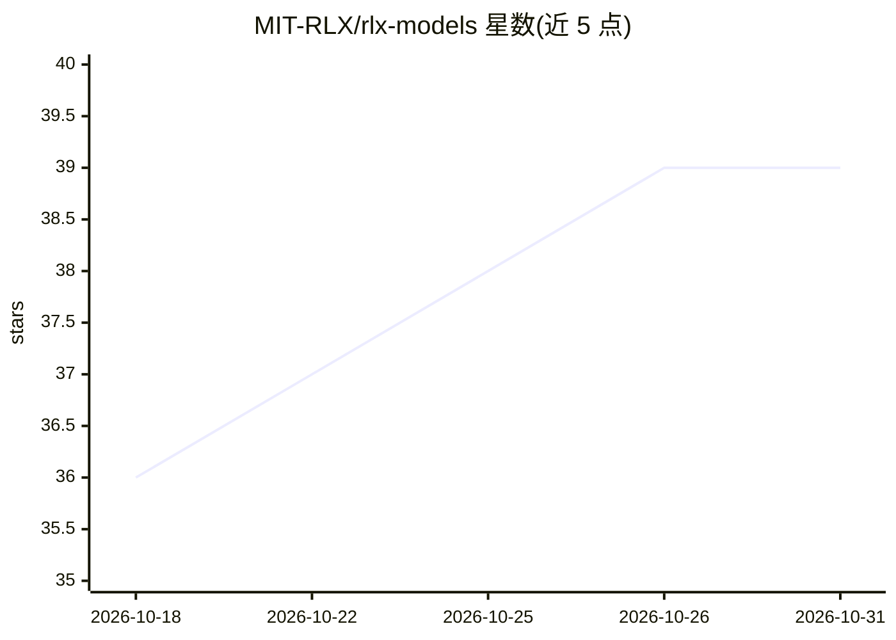

# MIT-RLX/rlx-models

⭐ 39 · Rust · GPL-3.0 · 推送 2026-10-29 · [GitHub](https://github.com/MIT-RLX/rlx-models) · [官网](https://crates.io/crates/rlx-models) · 组织维护

**RLX 编译器/运行时上的 184 个模型移植库（LLM/视觉/语音）**

面向 RLX 多后端编译器与运行时（CPU/Metal/MLX/CUDA/ROCm/wgpu）的模型图构建器与权重加载器集合：184 个模型家族各为独立 Rust crate，覆盖语言与多模态 LLM、视觉编码/检测/分割、ASR/TTS、音频编解码、唤醒词等 16 类，另含 4 个训练 crate。提供 facade 包、per-crate CLI 二进制、rlx-run 多路复用器与可选的 OpenAI 协议 HTTP 服务。需与 rlx 主仓库配合，通过 cargo 从源码构建。

## 筛选速览

| 维度 | 判定 | 备注 |
|---|---|---|
| AI 角色 | `ai-ecosystem` | LLM/agent 周边工具 |
| 许可风险 | `viral` | GPL-3.0 |
| 部署形态 | `self-host` | docker 或自建部署 |
| 模型依赖 | — | README 未给出锁定关系 |
| 硬件要求 | — | 无带数字的原话,不猜 |
| 安装摩擦 | `low` | 无编译、无系统依赖或容器化 |
| 成熟度 | — | 结构信号不足 |

## 能力要点

- 184 个模型家族，每架构一个 Rust crate，附 per-crate CLI 二进制
- 支持 CPU/Metal/MLX/CUDA/ROCm/wgpu/Vulkan 多种后端
- 包含 ASR/TTS/唤醒词/音频编解码等语音类模型 90+ 个
- 提供 GGUF/safetensors 权重加载与 OpenAI 协议 HTTP 服务（rlx-openai）

## 适用场景

- 在 rlx 运行时上本地运行 Qwen/Llama/Whisper/SAM 等模型
- 按需引入单个模型 crate 以缩短编译与链接
- 为 Rust 项目嵌入模型推理能力并选择硬件后端

## 场景标签

`语音识别` `语音合成` `多模态` `目标检测` · 领域:内容生成

## 证据(README 行号)

> L3: Concrete model graph builders + weight loaders for RLX — the "what actually runs" layer.
> L38: See **MODELS.md** for the complete list — every model, its crate, a one-line description, and the backends it suppo
> L143: Published `rlx*` crates (`rlx-runtime`, `rlx-flow`, …) are pinned at **0.2.8** in root `[workspace.dependencies]`;

## 星数曲线

2026-10-18 36 → 2026-10-31 39（+3）

---
*卡片 v1 · prompt 1.4 · 生成 2026-10-25 · 置信度 mid · 依据 README sha `8c621ea6ac68` · [字段定义](../../DATASET.md)*
