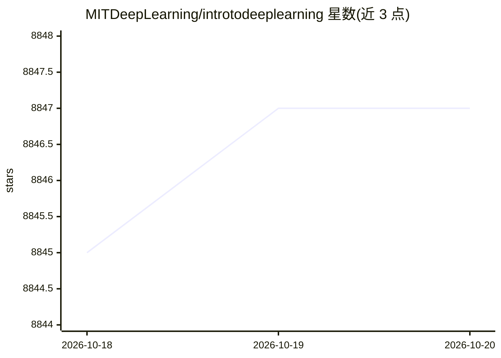

# MITDeepLearning/introtodeeplearning

⭐ 8,847 · Jupyter Notebook · MIT · 推送 2026-01-04 · [GitHub](https://github.com/MITDeepLearning/introtodeeplearning) · 组织维护

**MIT 深度学习入门课程（6.S191）的实验代码与软件 Lab 集合**

MIT Introduction to Deep Learning 课程的配套代码仓库，包含按 lab1/lab2/lab3 组织的 Jupyter notebook 实验，主题涵盖计算机视觉、深度强化学习、音乐生成等。实验设计在 Google Colaboratory 云端运行，需要 Google 账号，用户填写 #TODO 单元格完成练习；每个 lab 结尾附提交材料参加课程竞赛的说明。仓库同时提供 mitdeeplearning Python 包（pip 安装），内含课程通用的便捷函数，可在课程外独立使用。课件与讲座视频在课程网站公开，代码版权归 MIT 所有。

## 筛选速览

| 维度 | 判定 | 备注 |
|---|---|---|
| AI 角色 | `ai-knowledge` | 知识聚合/清单类 |
| 许可风险 | `permissive` | MIT |
| 部署形态 | `library` | 以包/库形式分发 |
| 模型依赖 | — | README 未给出锁定关系 |
| 硬件要求 | — | 无带数字的原话,不猜 |
| 安装摩擦 | `low` | 无编译、无系统依赖或容器化 |
| 成熟度 | — | 结构信号不足 |

## 能力要点

- lab1/lab2/lab3 的 Jupyter notebook 实验，需填写 #TODO 单元格
- 实验通过 Google Colaboratory 云端运行，无需本地下载
- 提供 mitdeeplearning pip 包，含课程通用便捷函数
- 讲座幻灯片与视频在课程网站公开

## 适用场景

- 按自己的节奏完成 MIT 深度学习课程实验
- 通过 Colab 零配置跑通 CV/强化学习/音乐生成实验
- 参加课程 lab 竞赛并学习提交流程

## 场景标签

`教程课程` · 领域:学习与行业

## 证据(README 行号)

> L3: This repository contains all of the code and software labs for MIT Introduction to Deep Learning! All lecture slides
> L6: MIT Introduction to Deep Learning software labs are designed to be completed at your own pace. At the end of each of

## 星数曲线

2026-10-18 8,845 → 2026-10-20 8,847（+2）

---
*卡片 v1 · prompt 1.4 · 生成 2026-10-20 · 置信度 high · 依据 README sha `b1aba73c337e` · [字段定义](../../DATASET.md)*
