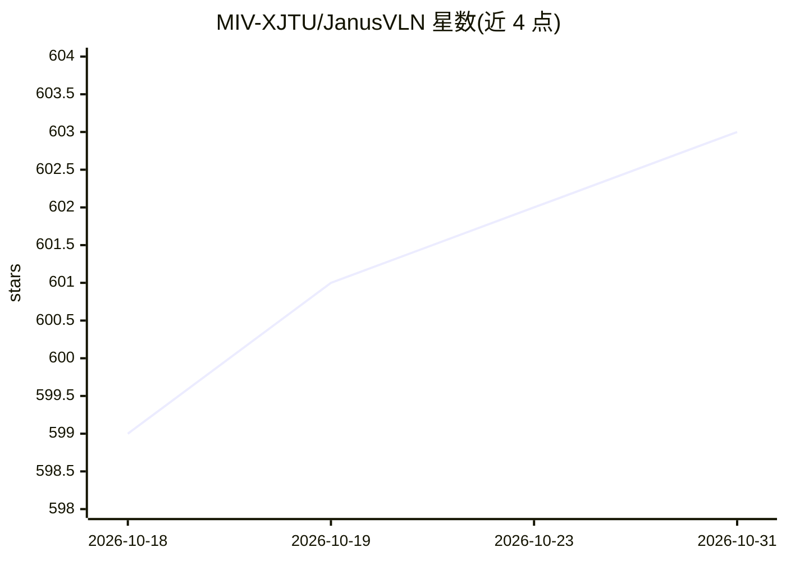

# MIV-XJTU/JanusVLN

⭐ 603 · Python · 推送 2026-08-17 · [GitHub](https://github.com/MIV-XJTU/JanusVLN) · [官网](https://miv-xjtu.github.io/JanusVLN.github.io/) · 组织维护 · 中文 README

**视觉语言导航框架：双隐式记忆解耦语义与空间认知**

ICLR 2026 论文的官方实现：JanusVLN 是视觉语言导航（VLN）框架，构建两个互补的固定大小神经记忆，分别对应语义理解与空间认知，在 R2R-CE、RxR-CE、ScaleVLN 等数据集上训练与评测。基于 Qwen2.5-VL、VGGT、StreamVLN 等代码库，提供模型权重下载、DAgger 数据采集与继续训练脚本，并用脚本在多 GPU 上推理评测。README 给出 Conda、Skill、Docker 三种环境配置教程，并在 A6000/A100 上报告了与论文指标的复现差异。面向具身智能方向的研究人员。

## 筛选速览

| 维度 | 判定 | 备注 |
|---|---|---|
| AI 角色 | `ai-native` | 本体是模型或模型工具 |
| 许可风险 | `none` | — |
| 部署形态 | `None` |  |
| 模型依赖 | — | README 未给出锁定关系 |
| 硬件要求 | — | 无带数字的原话,不猜 |
| 安装摩擦 | `low` | 无编译、无系统依赖或容器化 |
| 成熟度 | — | 结构信号不足 |

## 能力要点

- 双隐式记忆分别编码语义与空间信息
- 提供 Base 与 Extra 两组模型权重
- DAgger 数据采集与继续训练流程
- Conda / Skill / Docker 三种环境教程及复现指标

## 适用场景

- 在 R2R/RxR/ScaleVLN 基准上训练与评测 VLN 模型
- 复现论文指标并对比环境配置差异
- 采集 DAgger 轨迹数据做继续训练

## 场景标签

 · 领域:具身智能/视觉语言导航

## 证据(README 行号)

> L30: **JanusVLN** is a novel VLN framework and the first to feature a **dual implicit memory**. Inspired by the implicit
> L194: Our work is primarily based on the following codebases:Qwen2.5-VL, VGGT, StreamVLN, VG-LLM. We are sincerely grate

## 星数曲线

2026-10-18 599 → 2026-10-31 603（+4）

---
*卡片 v1 · prompt 1.4 · 生成 2026-10-22 · 置信度 high · 依据 README sha `f633ed914ceb` · [字段定义](../../DATASET.md)*
