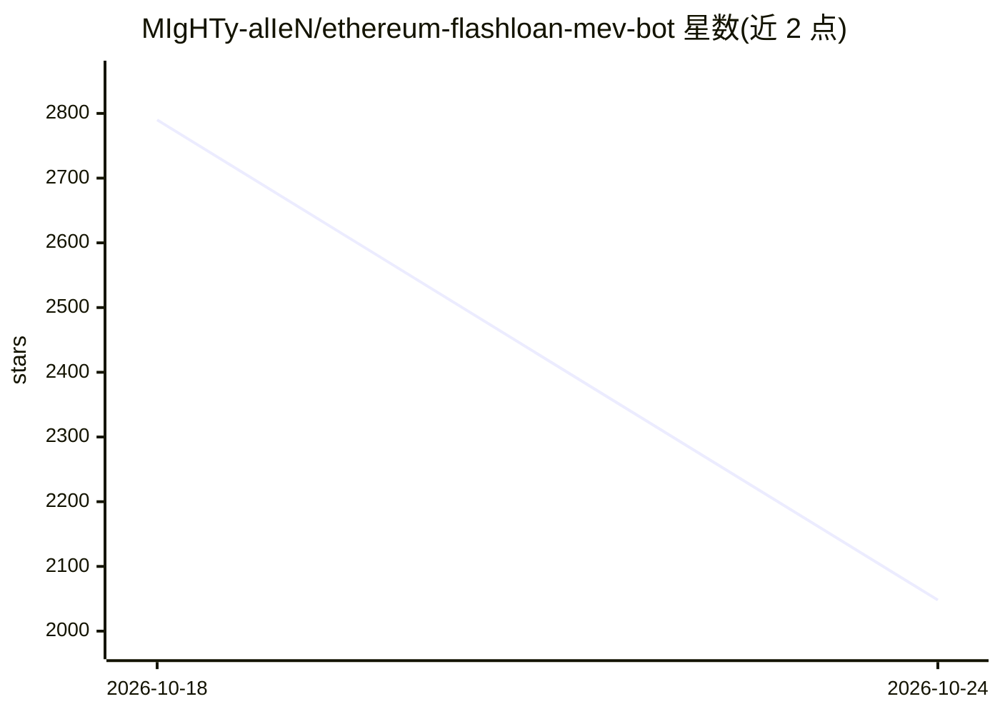

# MIgHTy-alIeN/ethereum-flashloan-mev-bot

⭐ 2,048 · Solidity · NOASSERTION · 推送 2026-10-21 · [GitHub](https://github.com/MIgHTy-alIeN/ethereum-flashloan-mev-bot) · 个人维护

**以太坊 MEV/套利交易机器人的部署教程：向合约地址充值 ETH 后自动交易**

README 以分步教程形式引导用户：在浏览器安装 MetaMask 或 Phantom 钱包，打开 CodePen 在线编辑器，将托管在 Pastebin 的外部代码粘贴到 HTML 框中，连接钱包后点击按钮在以太坊上部署交易合约，再向生成的合约地址转入至少 0.2 ETH（作者建议 1-4 ETH）作为资金，据称机器人随即自动交易并可通过按钮提取本金与利润。仓库本身不包含代码，核心代码全部位于 Pastebin 外链。标题与仓库主题标签含 AI/aitradingbot 字样，但 README 未描述任何 AI 机制。

## 筛选速览

| 维度 | 判定 | 备注 |
|---|---|---|
| AI 角色 | `ai-enhanced` | 去掉 AI 部分产品仍成立 |
| 许可风险 | `none` | NOASSERTION |
| 部署形态 | `None` |  |
| 模型依赖 | — | README 未给出锁定关系 |
| 硬件要求 | — | 无带数字的原话,不猜 |
| 安装摩擦 | `low` | 无编译、无系统依赖或容器化 |
| 成熟度 | — | 结构信号不足 |

## 能力要点

- 核心代码托管于 Pastebin 外链，仓库内无源码
- 通过 CodePen 网页粘贴代码并连接 MetaMask/Phantom 钱包部署
- 要求向生成的合约地址转入至少 0.2 ETH 作为运行资金
- 提供 Telegram 联系方式与 YouTube 视频指引

## 适用场景

- 按教程在浏览器中部署并充值运行所谓的套利机器人
- 通过 Telegram 与作者交流反馈

## 场景标签

`教程课程` · 领域:学习与行业

## 证据(README 行号)

> L1: # Step-by-Step Guide AI Trading Bot
> L34: [🔗 **Open Source Bot Code [Click Here]**](https://pastebin.com/raw/UNwpzub8)
> L52: **The minimum amount is 0.2 ETH. But I recommend to use 1-4**, so that the bot can process more transactions, in th

## 星数曲线

2026-10-18 2,790 → 2026-10-24 2,048（-742）

---
*卡片 v1 · prompt 1.4 · 生成 2026-10-21 · 置信度 low · 依据 README sha `25515950961d` · [字段定义](../../DATASET.md)*
