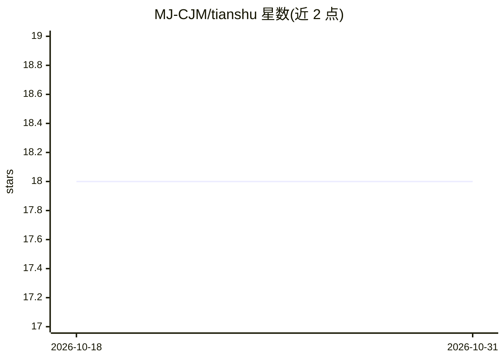

# MJ-CJM/tianshu

⭐ 18 · Python · MIT · 推送 2026-08-27 · [GitHub](https://github.com/MJ-CJM/tianshu) · 个人维护 · 中文 README

**可治理、可验证的自进化 Agent OS：任务执行与审计一体化平台**

天枢（Tianshu）是一个单机运行的 Agent OS，把任务下达（敕令）、排期、规划、执行、审计、通知与记忆成长组织为一条可审计闭环，通过 Web UI 管理。提供长程任务治理（检查点、人工裁决）、多官员（Agent）协同、知识记忆、技能演化的证据门禁与灰度回滚、成本预算与审计追溯。首个正式目标为 Ubuntu + Python 3.12 本地 desktop Web，单节点 SQLite 部署；官方容器、remote MCP 等标记为 deferred。经 PyPI（tianshu-agent-os）、pipx/uvx 或源码安装。

## 筛选速览

| 维度 | 判定 | 备注 |
|---|---|---|
| AI 角色 | `ai-ecosystem` | LLM/agent 周边工具 |
| 许可风险 | `permissive` | MIT |
| 部署形态 | `library` | 以包/库形式分发 |
| 模型依赖 | — | README 未给出锁定关系 |
| 硬件要求 | — | 无带数字的原话,不猜 |
| 安装摩擦 | `low` | 无编译、无系统依赖或容器化 |
| 成熟度 | `idea` | |

## 能力要点

- 敕令→排期→执行→审计→记忆的可审计任务闭环
- 长程任务由外层循环 actor→checks→critic 反复执行至验收或预算耗尽
- SystemAudit 防篡改链与 Evidence Bundle v1 记录行为、裁决与产物
- 技能候选经证据门禁、灰度分流与受控回滚的实验性自进化链路

## 适用场景

- 以可审计方式下达和管理长程 AI 任务
- 多 Agent 协同决策与委派治理
- 追踪任务执行证据、成本与失败归因
- 试验技能演化与外部编码 Agent 接入

## 场景标签

`多智能体` `Agent 框架` · 领域:Agent 开发

## 证据(README 行号)

> L122: 天枢把一次任务组织为一条可审计的核心闭环：下旨（Edict）→ 排期（Scheduler）→ 规划
> L124: 成长（Memory/Profile/Skill）。敕令可通过 Web、API、CLI、飞书或 Telegram 下达，系统把
> L131: 天枢把「敕令（Edict）→ 裁决（Decision）→ 运行 → Evidence → 技能候选 → 门禁 →

## 星数曲线

2026-10-18 18 → 2026-10-31 18（+0）

---
*卡片 v1 · prompt 1.4 · 生成 2026-10-29 · 置信度 high · 依据 README sha `e828e4e14108` · [字段定义](../../DATASET.md)*
