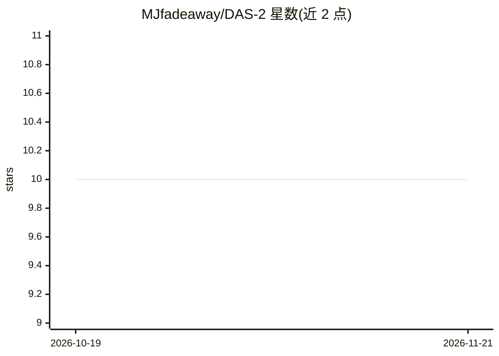

# MJfadeaway/DAS-2

⭐ 10 · Python · Apache-2.0 · 推送 2026-10-11 · [GitHub](https://github.com/MJfadeaway/DAS-2) · [官网](https://link.springer.com/article/10.1007/s10915-024-02711-1) · 组织维护

**面向科研人员：参数化微分方程代理模型的无标注深度自适应采样实现**

论文 Deep Adaptive Sampling for Surrogate Modeling Without Labeled Data 的官方实现代码库。提供基于物理信息深度学习的深度自适应采样方法，用于在无标注数据条件下构建参数化微分方程的代理模型，通过自适应选取配点降低随机采样带来的统计误差。附三组示例：算子学习、参数化最优控制、不同雷诺数（100–3200）范围的二维顶盖驱动方腔流。依赖 PyTorch/Numpy/Scipy/pyDOE，以 Python 脚本形式运行训练。

## 筛选速览

| 维度 | 判定 | 备注 |
|---|---|---|
| AI 角色 | `ai-native` | 本体是模型或模型工具 |
| 许可风险 | `permissive` | Apache-2.0 |
| 部署形态 | `None` |  |
| 模型依赖 | — | README 未给出锁定关系 |
| 硬件要求 | — | 无带数字的原话,不猜 |
| 安装摩擦 | `low` | 无编译、无系统依赖或容器化 |
| 成熟度 | — | 结构信号不足 |

## 能力要点

- 无标注数据的参数化偏微分方程代理建模方法实现
- 自适应配点采样以处理低正则性与高维问题
- 提供算子学习、最优控制、方腔流三组可复现实验脚本

## 适用场景

- 为参数化 PDE 求解器构建代理模型
- 复现论文中的算子学习与最优控制实验
- 研究物理信息深度学习中的自适应采样策略

## 场景标签

 · 领域:科研/科学机器学习

## 证据(README 行号)

> L2:  Official implementation for the paper Deep Adaptive Sampling for Surrogate Modeling Without Labeled Data
> L4: We propose a deep adaptive sampling approach for surrogate modeling of parametric differential equations without lab

## 星数曲线

2026-10-19 10 → 2026-11-21 10（+0）

---
*卡片 v1 · prompt 1.4 · 生成 2026-11-20 · 置信度 high · 依据 README sha `523e97370b98` · [字段定义](../../DATASET.md)*
