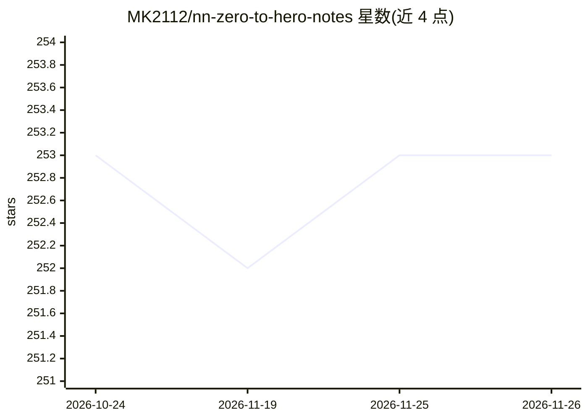

# MK2112/nn-zero-to-hero-notes

⭐ 253 · Jupyter Notebook · MIT · 推送 2026-11-20 · [GitHub](https://github.com/MK2112/nn-zero-to-hero-notes) · 个人维护

**Karpathy「神经网络从零到英雄」课程的笔记合集**

以 Jupyter Notebook 与 Markdown 形式整理 Andrej Karpathy 教程系列「Neural Networks: Zero to Hero」及演讲、大众向视频的笔记，覆盖 micrograd、makemore 系列、GPT 构建、分词器、GPT-2 复现及 LLM 概览等 12 期内容，多数条目附练习题与解答。面向观看该课程并需要额外概念梳理与文档化笔记的学习者。通过 git clone 获取，安装 requirements 后以 Jupyter Notebook 运行，Markdown 笔记可直接在 GitHub 或 Obsidian 阅读。仓库声明与 Karpathy 官方渠道无隶属关系。

## 筛选速览

| 维度 | 判定 | 备注 |
|---|---|---|
| AI 角色 | `ai-knowledge` | 知识聚合/清单类 |
| 许可风险 | `permissive` | MIT |
| 部署形态 | `library` | 以包/库形式分发 |
| 模型依赖 | — | README 未给出锁定关系 |
| 硬件要求 | — | 无带数字的原话,不猜 |
| 安装摩擦 | `medium` | 含编译或系统依赖之一 |
| 成熟度 | — | 结构信号不足 |

## 能力要点

- 覆盖 9 期教程、2 期通用视频与 3 场演讲的笔记
- 多数教程条目附练习题与解答版本
- 教程笔记为 Jupyter Notebook，演讲/通用笔记为 Markdown

## 适用场景

- 跟学 Zero to Hero 课程时对照笔记梳理概念
- 完成每期练习后核对参考解答
- 离线阅读 Markdown 格式的 LLM 演讲笔记

## 场景标签

`教程课程` · 领域:学习与行业

## 证据(README 行号)

> L7: Jupyter Notebooks and Markdown files with detailed notes on Andrej Karpathy's tutorial series "Neural Networks: Zero
> L9: ## Zero to Hero Tutorial Series

## 星数曲线

2026-10-24 253 → 2026-11-26 253（+0）

---
*卡片 v1 · prompt 1.4 · 生成 2026-11-25 · 置信度 high · 依据 README sha `c3fc15f202a9` · [字段定义](../../DATASET.md)*
