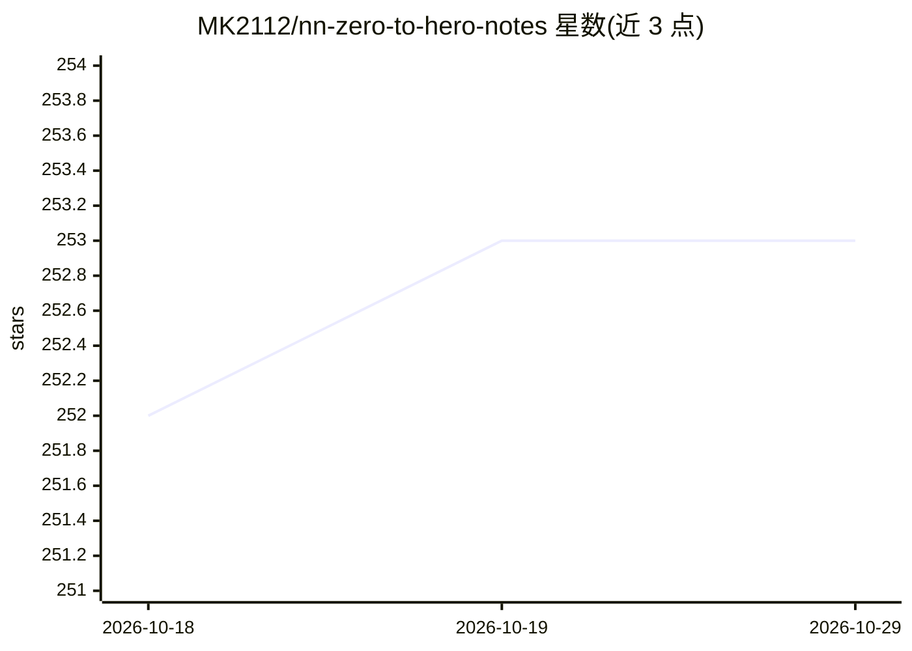

# MK2112/nn-zero-to-hero-notes

⭐ 253 · Jupyter Notebook · MIT · 推送 2026-10-01 · [GitHub](https://github.com/MK2112/nn-zero-to-hero-notes) · 个人维护

**Karpathy 神经网络课程的 Jupyter 学习笔记汇编**

针对 Andrej Karpathy 的 "Neural Networks: Zero to Hero" 教程系列、演讲及大众向视频整理的 Jupyter Notebook 与 Markdown 笔记，涵盖 micrograd、makemore 系列、WaveNet、GPT from scratch、GPT tokenizer、GPT-2 复现等主题，每篇附练习与已解练习。面向深度学习自学者，通过 git clone 克隆仓库、pip 安装依赖后在 Jupyter 中阅读运行，Markdown 笔记可直接在 GitHub 查看，作者推荐用 Obsidian 离线阅读。内容为对视频概念与技术的补充概览和文档，非官方仓库。

## 筛选速览

| 维度 | 判定 | 备注 |
|---|---|---|
| AI 角色 | `ai-knowledge` | 知识聚合/清单类 |
| 许可风险 | `permissive` | MIT |
| 部署形态 | `library` | 以包/库形式分发 |
| 模型依赖 | — | README 未给出锁定关系 |
| 硬件要求 | — | 无带数字的原话,不猜 |
| 安装摩擦 | `medium` | 含编译或系统依赖之一 |
| 成熟度 | — | 结构信号不足 |

## 能力要点

- 覆盖 9 篇 Zero to Hero 教程（micrograd 到 GPT-2 复现）
- 每篇笔记附练习与已解练习
- 另含演讲（State of GPT 等）与大众向视频的 Markdown 笔记
- 开源接受社区 PR 贡献

## 适用场景

- 跟随 Zero to Hero 系列学习神经网络与语言建模
- 查阅各讲的概念补充文档与练习答案
- 离线用 Obsidian 或 Jupyter 阅读学习材料

## 场景标签

`教程课程` · 领域:学习与行业

## 证据(README 行号)

> L7: Jupyter Notebooks and Markdown files with detailed notes on Andrej Karpathy's tutorial series "Neural Networks: Zero
> L16:  • N001 - Building Micrograd
> L49:  • N007 - GPT From Scratch

## 星数曲线

2026-10-18 252 → 2026-10-29 253（+1）

---
*卡片 v1 · prompt 1.4 · 生成 2026-10-22 · 置信度 mid · 依据 README sha `d69c0ca90f20` · [字段定义](../../DATASET.md)*
