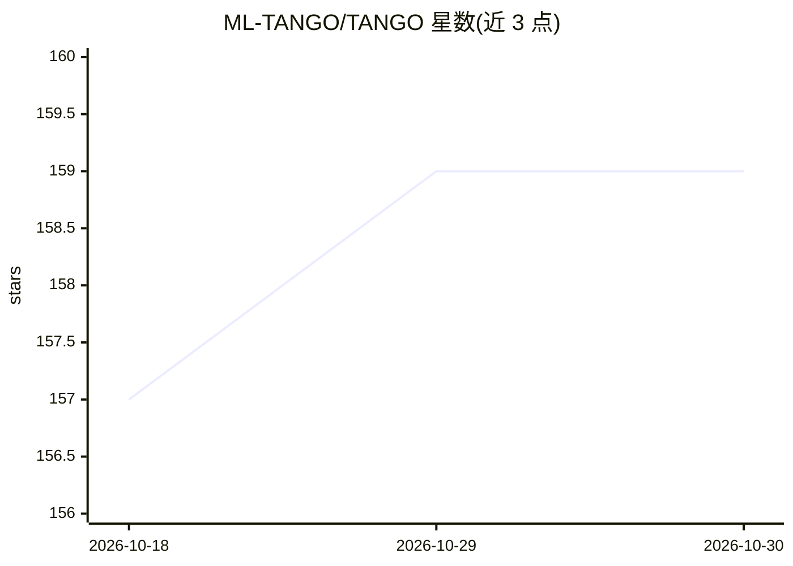

# ML-TANGO/TANGO

⭐ 159 · Python · NOASSERTION · 推送 2026-10-29 · [GitHub](https://github.com/ML-TANGO/TANGO) · 组织维护

**无代码神经网络自动生成与部署框架，面向视觉任务**

TANGO（Target Aware No-code neural network Generation and Operation framework）是为缺乏专业知识的用户提供的一体化机器学习框架：用户准备标注数据集与目标设备后，TANGO 通过 Web 标注工具、基础模型选择（按类别数与 GPU 显存推荐 YOLOv7/v9、ResNet 等）、NAS 与 HPO 自动生成并训练视觉模型（分类/检测/实例分割），随后生成代码、构建容器镜像并部署到云、K8S 或边缘设备。支持多推理引擎转换（ONNX/TFLite/TensorRT/TVM 等）与量化。限制：部分目标（KT cloud、Comma 3X）标注为 in progress。

## 筛选速览

| 维度 | 判定 | 备注 |
|---|---|---|
| AI 角色 | `ai-ecosystem` | LLM/agent 周边工具 |
| 许可风险 | `none` | NOASSERTION |
| 部署形态 | `self-host` | docker 或自建部署 |
| 模型依赖 | — | README 未给出锁定关系 |
| 硬件要求 | — | 无带数字的原话,不猜 |
| 安装摩擦 | `low` | 无编译、无系统依赖或容器化 |
| 成熟度 | — | 结构信号不足 |

## 能力要点

- 按类别数与 GPU 显存自动推荐基础模型（YOLOv7/v9、ResNet 系列）
- NAS + HPO（贝叶斯超参优化、自动 batch、早停、数据增强）自动生成模型
- 多格式模型导出：pt/onnx/torchscript/TensorFlow/TFLite/TPU，支持 INT8 量化
- 部署目标覆盖 AWS/GCP/K8S、Jetson 系列、Galaxy 手机、树莓派 5、Odroid 等边缘设备

## 适用场景

- 没有深度学习经验的用户从标注数据到部署视觉模型的端到端流程
- 在边缘设备（Jetson、手机、树莓派）上部署自动优化的检测/分类模型
- 通过 Web GUI 完成数据标注并可视化模型结构与训练进度

## 场景标签

`MLOps` `模型训练` `模型量化` · 领域:训练与推理

## 证据(README 行号)

> L11: TANGO (**T**arget **A**ware **N**o-code neural network **G**eneration and **O**peration framework) is code name of 
> L13: It aims to develop automatic neural network generation and deployment framework that helps novice users to easily d
> L17: > The TANGO framework aims to help users without specialized knowledge to create and use their own neural network m

## 星数曲线

2026-10-18 157 → 2026-10-30 159（+2）

---
*卡片 v1 · prompt 1.4 · 生成 2026-10-22 · 置信度 high · 依据 README sha `e08455cf9a6a` · [字段定义](../../DATASET.md)*
