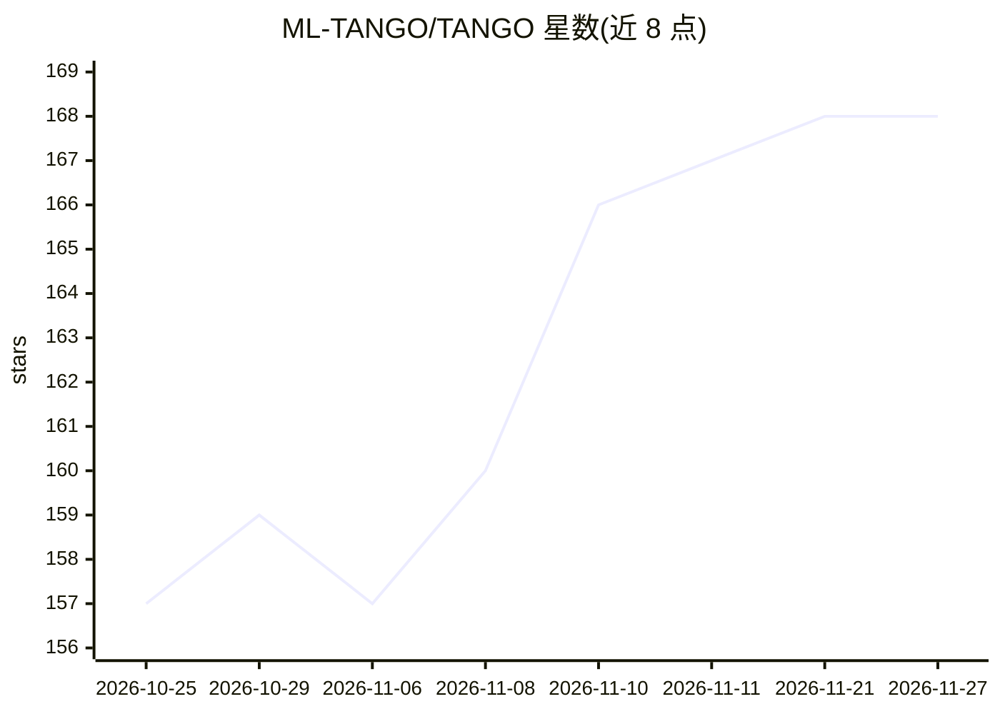

# ML-TANGO/TANGO

⭐ 168 · Python · NOASSERTION · 推送 2026-10-29 · [GitHub](https://github.com/ML-TANGO/TANGO) · 组织维护

**面向新手的无代码神经网络自动生成与部署框架**

TANGO 是一个集成机器学习框架（Target Aware No-code neural network Generation and Operation），面向无专业知识的用户：用户只需准备带标注的数据集并指定目标设备，框架自动完成数据分析、基座模型选择、NAS/HPO 自动生成神经网络、训练、Docker 容器镜像构建并部署到目标设备。组件以容器与微服务架构（MSA）实现，通过 REST API 交互。内置 Web 标注工具、模型/训练可视化；聚焦分类、目标检测、实例分割三类视觉任务；2026 年 1 月为最终官方发布。

## 筛选速览

| 维度 | 判定 | 备注 |
|---|---|---|
| AI 角色 | `ai-ecosystem` | LLM/agent 周边工具 |
| 许可风险 | `none` | NOASSERTION |
| 部署形态 | `self-host` | docker 或自建部署 |
| 模型依赖 | — | README 未给出锁定关系 |
| 硬件要求 | — | 无带数字的原话,不猜 |
| 安装摩擦 | `low` | 无编译、无系统依赖或容器化 |
| 成熟度 | — | 结构信号不足 |

## 能力要点

- 无代码流程：数据集+目标设备输入，自动生成、训练并部署神经网络
- 基座模型选择规则表按任务/类别数/GPU 内存推荐 YOLOv7、YOLOv9、ResNet 等
- AutoNN 提供 NAS、HPO、贝叶斯超参调优、自动导出（pt/onnx/torchscript/tensorflow/TFLite/TPU，支持 INT8 量化）
- 支持 cloud/K8S/ondevice 多目标部署，含 Jetson、Galaxy、树莓派等设备清单

## 适用场景

- 不懂代码但想为视觉任务训练并部署模型
- 把训练好的模型打包成容器部署到边缘设备
- 需要 Web 标注工具完成图像标注

## 场景标签

`目标检测` `MLOps` · 领域:感知与多模态

## 证据(README 行号)

> L17: TANGO (**T**arget **A**ware **N**o-code neural network **G**eneration and **O**peration framework) is code name of 
> L19: It aims to develop automatic neural network generation and deployment framework that helps novice users to easily d
> L23: > The TANGO framework aims to help users without specialized knowledge to create and use their own neural network m

## 星数曲线

2026-10-25 157 → 2026-11-27 168（+11）

---
*卡片 v1 · prompt 1.4 · 生成 2026-11-26 · 置信度 high · 依据 README sha `06cd0b9d04fe` · [字段定义](../../DATASET.md)*
