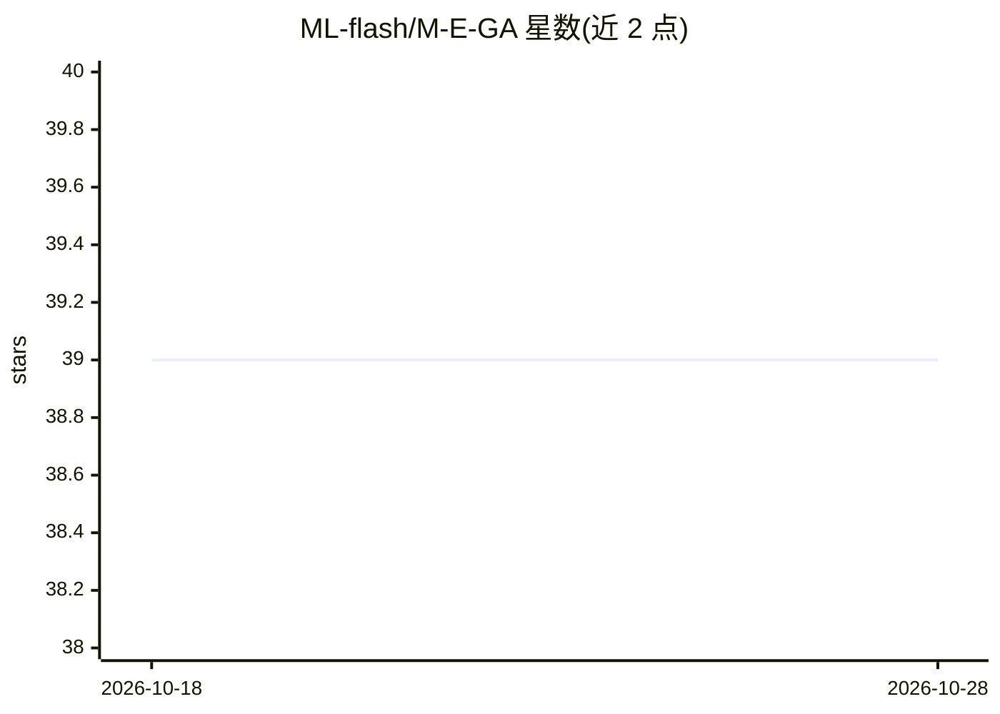

# ML-flash/M-E-GA

⭐ 39 · Python · GPL-3.0 · 推送 2026-06-02 · [GitHub](https://github.com/ML-flash/M-E-GA) · [官网](https://publicaiplayground.com/mega) · 个人维护

**可变编码遗传算法框架，支持迁移学习与自定义实验**

MEGA 是一个 Python 实现的通用遗传算法框架，采用可变编码（Mutable Encoding）：通过持续捕获、嵌套与精炼 meta-gene 实现基因表示层面的元进化，学习到的编码可迁移到新初始化的 GA 实例。架构上分为 M_E_Engine、M_E_GA_base 与实验层，适配度函数与主 GA 解耦，用户可自定义基因、实验流程与 ALife 仿真场景。内部使用 xxhash 生成可哈希编码、functools LRU 缓存解码、concurrent 线程并行评估种群。以 pip 包 M_E_GA2 安装，自带 unittest 测试；作者声明代码仍在开发与研究中。

## 筛选速览

| 维度 | 判定 | 备注 |
|---|---|---|
| AI 角色 | `ai-native` | 本体是模型或模型工具 |
| 许可风险 | `viral` | GPL-3.0 |
| 部署形态 | `library` | 以包/库形式分发 |
| 模型依赖 | — | README 未给出锁定关系 |
| 硬件要求 | — | 无带数字的原话,不猜 |
| 安装摩擦 | `low` | 无编译、无系统依赖或容器化 |
| 成熟度 | `idea` | |

## 能力要点

- 可变编码与 meta-gene 元进化机制
- 学习到的编码可迁移到新 GA 实例
- 自定义适配度函数与实验流程（含 ALife 仿真场景）
- xxhash 编码、LRU 缓存解码与线程并行评估

## 适用场景

- 研究可变编码遗传算法的搜索行为
- 构建自定义适配度函数的进化优化实验
- 在 ALife 仿真中定义种群繁殖条件

## 场景标签

 · 领域:进化计算/机器学习框架

## 证据(README 行号)

> L28: - MEGA takes an entirely different approach to GA, making it both the same and fundamentally different from traditi
> L56: MEGA is designed to be modular and fairly easy to build on. The M_E_Engine is distinct from the M_E_GA_base, which 

## 星数曲线

2026-10-18 39 → 2026-10-28 39（+0）

---
*卡片 v1 · prompt 1.4 · 生成 2026-10-25 · 置信度 mid · 依据 README sha `11aab939852f` · [字段定义](../../DATASET.md)*
