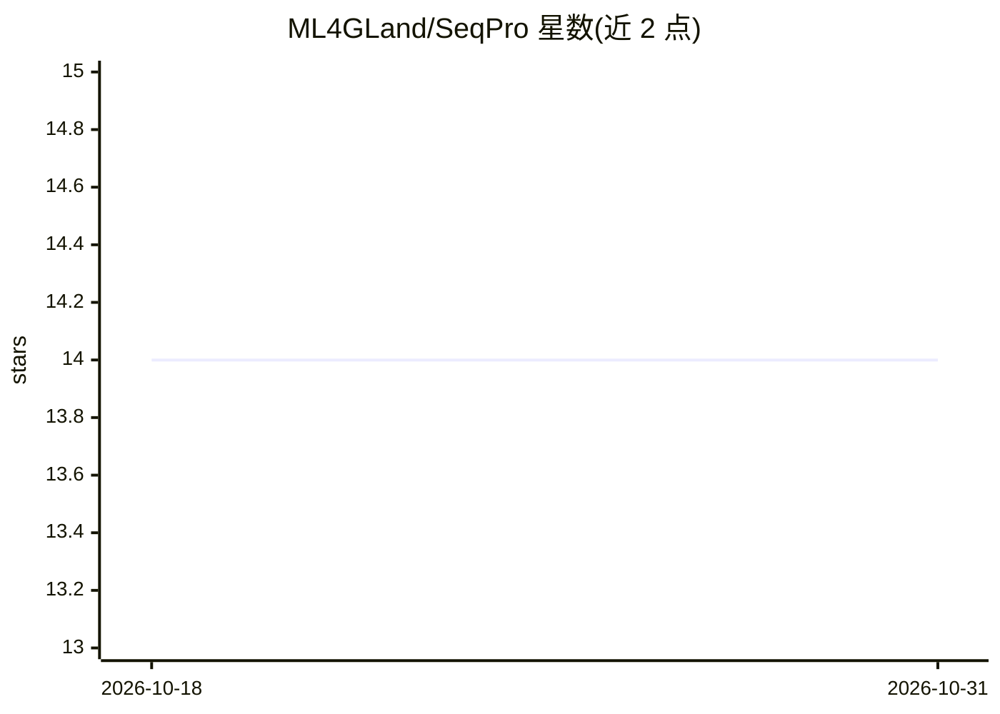

# ML4GLand/SeqPro

⭐ 14 · Python · MIT · 推送 2026-09-26 · [GitHub](https://github.com/ML4GLand/SeqPro) · [官网](https://ml4gland.github.io/SeqPro/) · 组织维护

**DNA/RNA/蛋白质序列预处理 Python 库**

SeqPro 是一个用于处理 DNA/RNA 序列（支持蛋白质序列）的 Python 包，输入可为字符串、NumPy 字符串数组、S1 字节数组或 one-hot 编码数组，变长序列通过 seqpro.rag 的 Ragged 数组支持。提供 DNA/RNA/氨基酸三种内置字母表，含 one-hot 编码/解码、反向互补、密码子翻译等操作；计算瓶颈用 Numba 和 Rust（PyO3/maturin）加速。可独立使用，也被 SeqData、SeqExplainer、EUGENe 等包调用；XArray 集成为实验性功能。

## 筛选速览

| 维度 | 判定 | 备注 |
|---|---|---|
| AI 角色 | `ai-enhanced` | 去掉 AI 部分产品仍成立 |
| 许可风险 | `permissive` | MIT |
| 部署形态 | `library` | 以包/库形式分发 |
| 模型依赖 | — | README 未给出锁定关系 |
| 硬件要求 | — | 无带数字的原话,不猜 |
| 安装摩擦 | `low` | 无编译、无系统依赖或容器化 |
| 成熟度 | — | 结构信号不足 |

## 能力要点

- 支持字符串/NumPy 数组/one-hot 编码等多种序列输入形式
- seqpro.rag 子模块以 Ragged 数组支持变长序列集合
- Numba 与 Rust（PyO3）加速填充、one-hot、k-mer shuffle 等操作
- 内置 DNA/RNA/氨基酸三种字母表及反向互补、密码子翻译

## 适用场景

- 为基因组学/调控基因组学流程做序列编码与变换
- 处理变长序列集合用于机器学习输入准备
- 作为 EUGENe、SeqExplainer 等包的底层序列处理依赖

## 场景标签

 · 领域:生物信息学/调控基因组学

## 证据(README 行号)

> L10: SeqPro is a Python package for processing DNA/RNA sequences, with support for protein sequences. SeqPro is fully fu
> L14: Computational bottlenecks or code that is impossible to vectorize with NumPy alone are accelerated with Numba (e.g.

## 星数曲线

2026-10-18 14 → 2026-10-31 14（+0）

---
*卡片 v1 · prompt 1.4 · 生成 2026-10-31 · 置信度 mid · 依据 README sha `b22392eefd07` · [字段定义](../../DATASET.md)*
