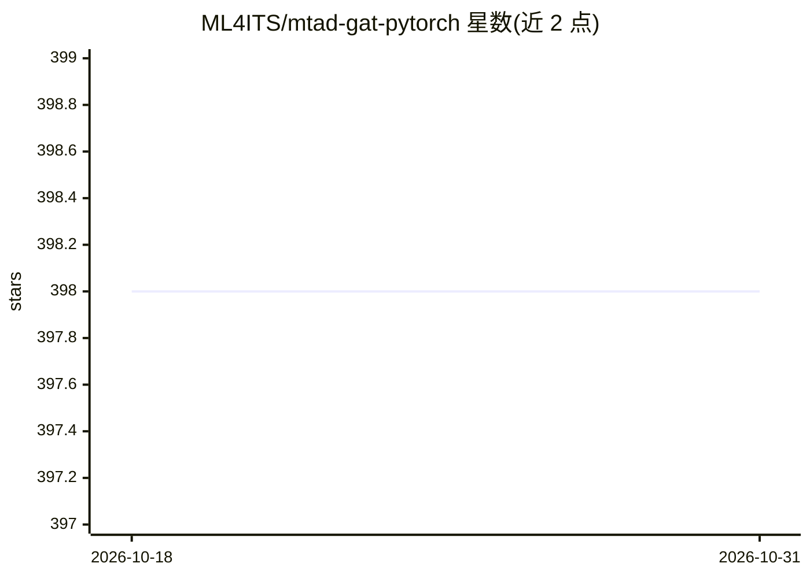

# ML4ITS/mtad-gat-pytorch

⭐ 398 · Python · MIT · 推送 2026-09-18 · [GitHub](https://github.com/ML4ITS/mtad-gat-pytorch) · 组织维护

**图注意力网络做多变量时间序列异常检测的 PyTorch 实现**

MTAD-GAT（Zhao et al. 2020）的 PyTorch 实现，构建完整的多变量时间序列异常检测框架：1-D 卷积平滑后经特征向与时间向两个并行图注意力层（默认 GATv2，可选标准 GAT）捕获依赖，再接 GRU 与预测/重构模型（GRU 解码器替代 VAE）。提供 POT、Hundman 等多种阈值方法并同时输出对比结果，支持 MSL/SMAP/SMD 数据集的训练与结果可视化。声明不复现原论文结果，仓库处于非活跃维护状态。

## 筛选速览

| 维度 | 判定 | 备注 |
|---|---|---|
| AI 角色 | `ai-native` | 本体是模型或模型工具 |
| 许可风险 | `permissive` | MIT |
| 部署形态 | `library` | 以包/库形式分发 |
| 模型依赖 | — | README 未给出锁定关系 |
| 硬件要求 | — | 无带数字的原话,不猜 |
| 安装摩擦 | `low` | 无编译、无系统依赖或容器化 |
| 成熟度 | — | 结构信号不足 |

## 能力要点

- 特征向+时间向双图注意力层（GATv2/标准 GAT 可选）
- GRU 解码器替代 VAE 作为重构模型
- POT、Hundman、暴力搜索三种阈值方法并同时输出对比
- 支持 MSL/SMAP/SMD 数据集与 Jupyter 结果可视化

## 适用场景

- 在 MSL/SMAP/SMD 基准上训练时间序列异常检测模型
- 比较不同阈值方法对异常检测 F1 的影响
- 基于图注意力网络研究多变量时序异常检测

## 场景标签

 · 领域:时间序列异常检测/深度学习

## 证据(README 行号)

> L5: Our implementation of MTAD-GAT: Multivariate Time-series Anomaly Detection (MTAD) via Graph Attention Networks (GAT)
> L7: - This repo includes a complete framework for multivariate anomaly detection, using a model that is heavily inspired

## 星数曲线

2026-10-18 398 → 2026-10-31 398（+0）

---
*卡片 v1 · prompt 1.4 · 生成 2026-10-21 · 置信度 mid · 依据 README sha `54240354479f` · [字段定义](../../DATASET.md)*
