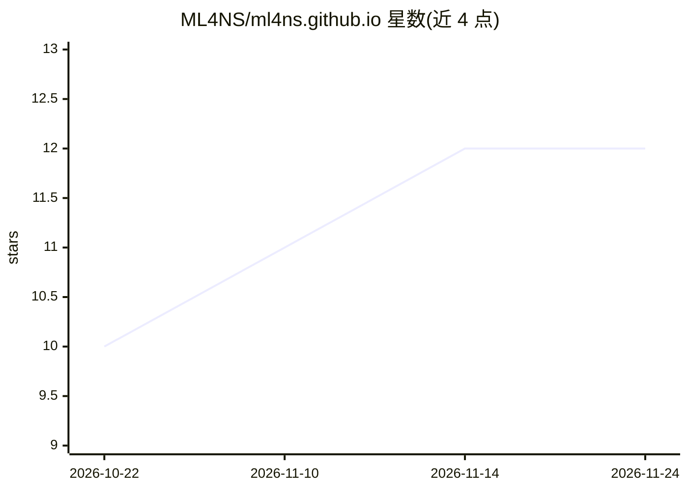

# ML4NS/ml4ns.github.io

⭐ 12 · Jupyter Notebook · 推送 2026-01-19 · [GitHub](https://github.com/ML4NS/ml4ns.github.io) · [官网](https://ml4ns.github.io/) · 组织维护

**帝国理工神经科学机器学习课程站点入口页**

该仓库为 Machine Learning for Neuroscience 课程（2026 春季，帝国理工学院转化神经科学硕士项目相关）的站点仓库。README 仅提供指向主站 ml4ns.github.io 的跳转链接，课程内容、讲义与代码需访问主站获取。维护主体为大学课程团队，面向神经科学研究/学习场景的用户。

## 筛选速览

| 维度 | 判定 | 备注 |
|---|---|---|
| AI 角色 | `ai-knowledge` | 知识聚合/清单类 |
| 许可风险 | `none` | — |
| 部署形态 | `None` |  |
| 模型依赖 | — | README 未给出锁定关系 |
| 硬件要求 | — | 无带数字的原话,不猜 |
| 安装摩擦 | `low` | 无编译、无系统依赖或容器化 |
| 成熟度 | — | 结构信号不足 |

## 能力要点

- 指向课程主站 ml4ns.github.io 的入口链接
- 关联帝国理工学院转化神经科学硕士项目

## 适用场景

- 查找神经科学机器学习课程资料入口
- 了解该课程所属研究生项目信息

## 场景标签

`教程课程` · 领域:学习与行业

## 证据(README 行号)

> L1: Please visit the main page:
> L3: https://ml4ns.github.io/

## 星数曲线

2026-10-22 10 → 2026-11-24 12（+2）

---
*卡片 v1 · prompt 1.4 · 生成 2026-11-18 · 置信度 mid · 依据 README sha `1f7046bacab5` · [字段定义](../../DATASET.md)*
